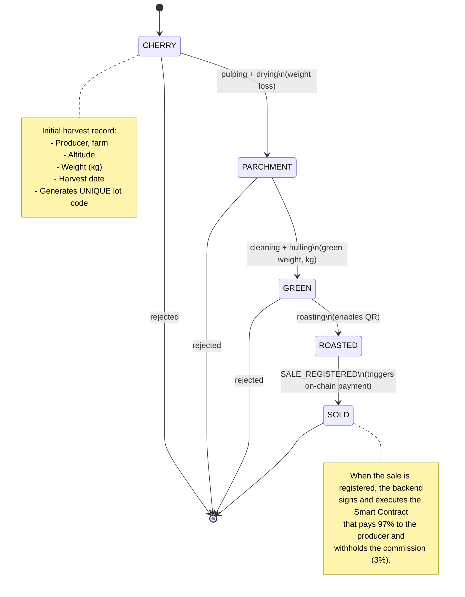
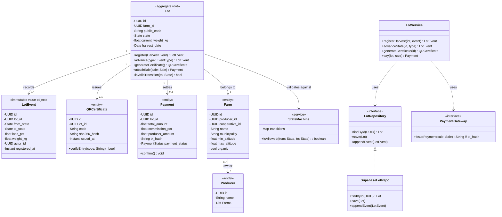
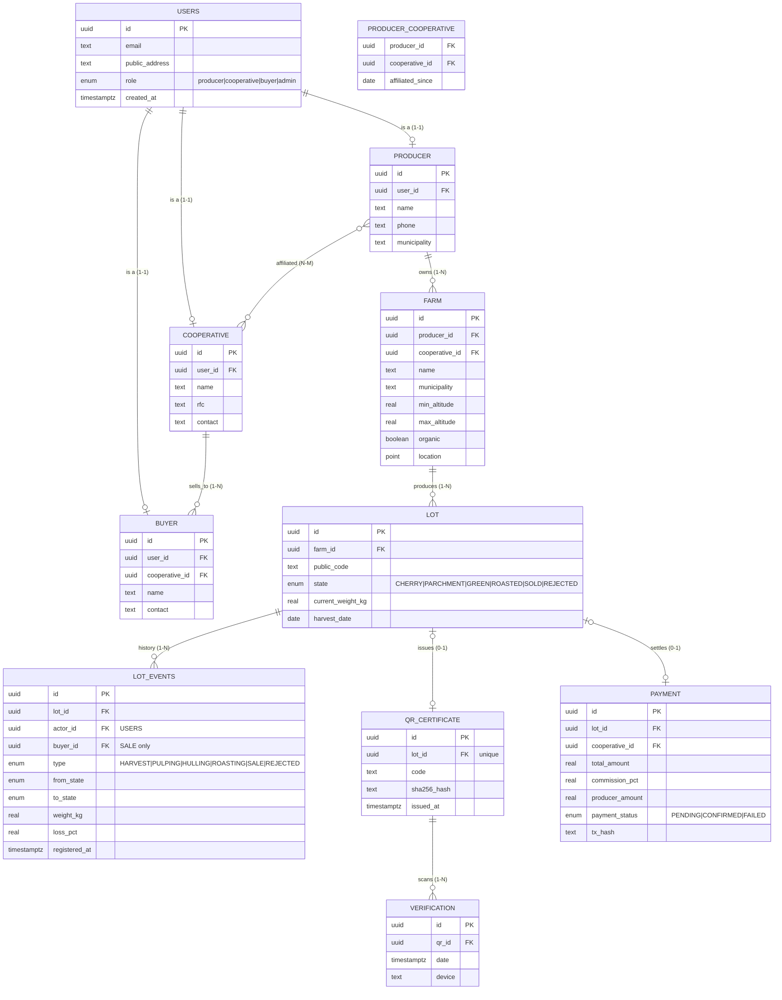
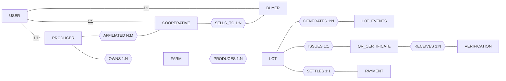
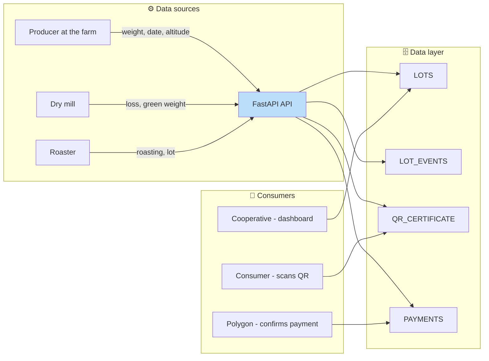
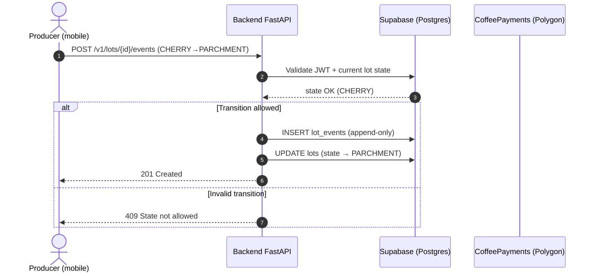
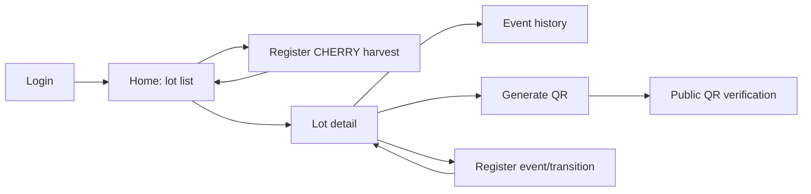
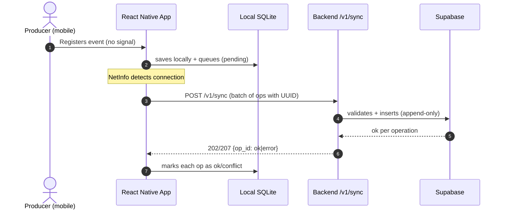
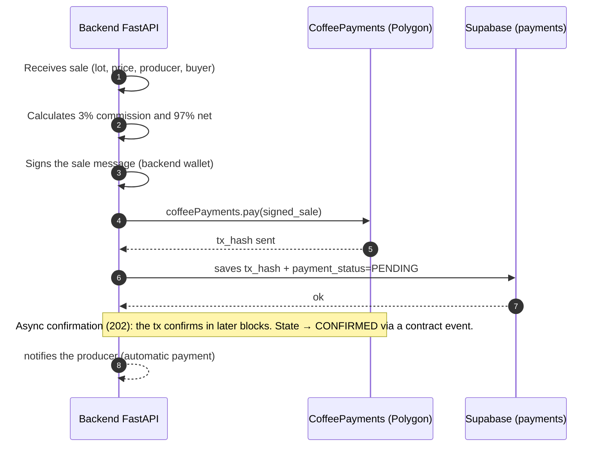

# Bean Trust Architecture

> Reference document for autonomous team development.
> Goal: for any team member to understand **what each piece does** and **why it's designed this way**, before writing code.

> *This is the English translation of [`ARCHITECTURE.md`](./ARCHITECTURE.md). If the two ever diverge, treat the Spanish version as the source of truth and flag the mismatch.*

---

## 1. What is Bean Trust? (30-second summary)

Bean Trust is a **blockchain platform for traceability and fair trade of coffee from Veracruz**.

It solves two problems documented in the project's technical memory:

1. **Coyotaje / excessive intermediation**: a middleman absorbs up to 70% of the coffee's value.
2. **Lack of trustworthy certification**: paper certifications are slow, expensive, and forgeable.

The system gives each coffee bean a **digital identity** through blockchain technology:

- Records key events in the chain (harvest, processing, roasting) **immutably**.
- Issues a **Certificate of Origin**: a unique **QR code** the consumer scans to verify certified organic origin (producer, farm, altitude, process history).
- Executes **fair, automatic payments** to the producer via **Smart Contracts**.

Business model (B2B2C): the producer **does not pay**. Cooperatives (subscription) and specialty buyers (3% transaction fee executed by the Smart Contract) pay. The end consumer just scans the QR; their demand for transparency is what gives value to the whole chain.

---

## 2. Architecture overview

```
┌─────────────────────┐      ┌───────────────────────────┐
│      Mobile App     │      │    Polygon Network (L2)    │
│ (React Native/Expo) │      │   ┌────────────────────┐  │
│                     │      │   │ Smart Contract     │  │
│ ┌───────────────┐   │      │   │ CoffeePayments.sol │  │
│ │ Local SQLite  │   │      │   └─────────┬──────────┘  │
│ │(offline queue)│   │      │             │ web3         │
│ └───────┬───────┘   │      └─────────────┼─────────────┘
└─────────┼───────────┘                    │
          │ HTTP/JSON (API)                │
┌─────────┼────────────────────────────────┼───────────┐
│ Backend ▼                                ▼           │
│ ┌─────────────────────────┐  ┌─────────────────────┐ │
│ │ Contract API             │  │ Web3 Module         │ │
│ │ (FastAPI)                │  │ (web3.py / scripts) │ │
│ │ - Business rules         │  │ - Signing            │ │
│ │ - Public QR              │  │ - Testnet deploy    │ │
│ │ - Offline sync           │  │                     │ │
│ └───────────┬─────────────┘  └─────────────────────┘ │
│             │ SQL                                      │
│             ▼                                          │
│   ┌─────────────────────┐                              │
│   │ Supabase            │                              │
│   │ (PostgreSQL + Auth) │                              │
│   │ + RLS + Storage     │                              │
│   └─────────────────────┘                              │
└────────────────────────────────────────────────────────┘
```

### Separation of responsibilities (modular decision)

- **FastAPI** is the only gate that validates business rules and the only one that knows the coffee state machine. **The app never writes directly to the database.**
- **Supabase** is the relational source of truth (PostgreSQL) + Auth + Row Level Security (RLS) + QR Storage (Backend-as-a-Service).
- **Smart Contracts (Polygon)**: only contain the *flow of money*, never the full business logic.

| Component | Role | Consumed by |
|---|---|---|
| **Mobile App** | Field registration, QR, basic dashboards | Producers, cooperatives |
| **FastAPI** | Contract API, orchestration, state rules, sync, web3 | Mobile, public QR |
| **Supabase** | Relational persistence, Auth, RLS, Storage | FastAPI, web dashboards |
| **Smart Contracts** | Automatic fair payment, on-chain immutability | Backend, cooperatives |
| **Docs / ADR** | Decisions, diagrams, business rules | Whole team |

---

## 3. Folder structure (monorepo)

```
BeanTrust/
├── docs/
│   ├── ARCHITECTURE.md          # ← This document (Spanish original)
│   ├── ARCHITECTURE.en.md       # ← English translation
│   ├── 01-coffee-domain.md       # State machine (Issue 1)
│   ├── 02-data-model.md          # ERD + migrations (Issue 2)
│   ├── 03-api-contract.md        # Endpoints + schemas (Issue 3)
│   ├── 04-ui-flow.md             # Wireframes + navigation (Issue 4)
│   ├── 05-offline-sync.md        # Offline sync (Issue 5)
│   └── adr/                      # Architecture Decision Records (ADR)
├── Backend/                     # FastAPI
│   ├── app/
│   │   ├── main.py              # Entry point: instantiates FastAPI(), mounts routers
│   │   ├── core/                 # config, security (Supabase JWT), logger
│   │   ├── api/v1/
│   │   │   └── endpoints/        # lots, events, verification, payments, auth, sync (1 router per domain)
│   │   ├── models/                # Data schema (SQLAlchemy / Supabase)
│   │   ├── schemas/               # Pydantic → input/output validation
│   │   ├── services/              # state_machine, qr_service, blockchain_link
│   │   ├── repositories/          # LotRepository (interface) + SupabaseLotRepo (impl.) — see §4
│   │   ├── utils/                 # pure stateless helpers (hashing, formatting, etc.)
│   │   └── dependencies.py        # Shared dependency injection (DB, Auth) — see §4
│   ├── tests/
│   │   ├── unit/
│   │   └── integration/
│   └── pyproject.toml
├── mobile/                     # React Native (Expo Router)
│   ├── app/                    # Screens (registration, lot, QR, sync...)
│   ├── src/
│   │   ├── components/         # Reusable UI components
│   │   ├── api/                # HTTP client (per module)
│   │   ├── db/                 # Local SQLite (expo-sqlite / WatermelonDB)
│   │   └── supabase/           # Supabase client (Auth, reads)
│   └── sync/                   # Offline operation queue
├── contracts/                  # Solidity (Foundry)
│   ├── src/CoffeePayments.sol  # ← Main contract
│   ├── src/interfaces/
│   ├── test/                   # Contract tests
│   └── script/                 # Deployment to Polygon (testnet/mainnet)
├── db/                         # SQL migrations + seed
└── README.md
```

---

## 4. Domain model: the journey of the bean

> Golden rule: the **Lot** is the base entity (aggregate / core of the model) and moves through discrete **states**. The **history** of a Lot is a list of **immutable events** that is **never rewritten** (append-only).

### Coffee states



### Transition business rules (summary)

| Transition | Required action | Fields checked |
|---|---|---|
| `CHERRY → PARCHMENT` | Pulping + drying | `loss_pct`, `weight_kg`, `actor_id` |
| `PARCHMENT → GREEN` | Cleaning + hulling | `weight_kg`, `loss_pct` |
| `GREEN → ROASTED` | Roasting at the plant | roasting date (`registered_at`) |
| `ROASTED → SOLD` | Price/sale registration | `total_amount`, `buyer_id`, `tx_hash` |

**Business invariants (prohibitions)**:
- Cannot skip two states at once (`CHERRY → GREEN` = error).
- No going back after `ROASTED` (physically irreversible).
- Weight loss can never be negative.
- Every event records who did it (`actor_id`) and a timezone-aware `timestamp` (UTC).

### Object-oriented design (OOP) — the heart of the domain

> **Why OOP?** Bean Trust's problem is a **rich domain model**: the Lot is not a simple record, it's an object that **has a lifecycle**, **validates its own transitions**, and **issues its certificate and payment**. Modeling it with objects lets those rules live **next to the data** (encapsulation) instead of scattered across scripts.

Concrete benefits we get from OOP here (based on the Python skill + DDD domain pattern):

1. **Encapsulation**: `Lot` knows its history and *can't be tricked* into jumping from CHERRY straight to GREEN. The caller simply asks to "advance"; the object validates or raises an error.
2. **Event immutability**: `LotEvent` is an **immutable value object**: it's created and never modified. This is what makes traceability verifiable (same principle as append-only in the DB).
3. **Controlled polymorphism** for states: each state (`CherryState`, `ParchmentState`, …) can have its own exit-validation logic. It's managed with the **StateMachine** (State pattern), not with giant `if/case` blocks in the API.
4. **Dependency Inversion (DI)**: the application service depends on **interfaces** (`LotRepository`, `PaymentGateway`), not directly on Supabase or Polygon → infrastructure changes don't touch business logic.

**OOP best practices from the Python skill applied to this domain:**

| Skill (best practice) | How it's applied in Bean Trust |
|---|---|
| **Pydantic at the boundaries (schemas)** | The domain `Lot` is a plain class (or `@dataclass`); `LotCreate`/`EventCreate` with Pydantic validate input/output **in the router**. Transport validation isn't mixed with business logic. |
| **Immutable value object (`frozen=True`)** | `LotEvent` is defined `@dataclass(frozen=True)`: it's created, read, never modified → history can't be altered or reordered. (Skill gotcha: `dataclass` for internal structs, Pydantic only at API boundaries.) |
| **`Enum` instead of magic strings** | `State` and `EventType` are Python `enum.Enum`: the compiler/linter catches typos and only allows valid values in `StateMachine`. |
| **Careful with `bool` as a subclass of `int`** | When validating `isValidTransition(...)`, never compare with `== True`; use `is` or type `bool` explicitly in the signature (skill gotcha). |
| **FastAPI `Depends` for DI** | Repositories/gateways (`SupabaseLotRepo`, `PaymentGateway`) are injected with `Annotated` + `Depends` (FastAPI skill). The domain talks only to interfaces → testable with mocks. |
| **No bare `dict`s** | Everything that crosses the boundary goes through typed Pydantic models; the domain never receives a `dict.get("x")` that can silently fail (skill gotcha). |

**Class diagram (OOP):**



**Why each element exists:**

| Class | Why it exists | OOP principle |
|---|---|---|
| `Lot` (aggregate) | Single root identity that guarantees data consistency | Aggregate + Encapsulation |
| `LotEvent` | History is **immutable**: it's the evidence of traceability | Immutability / Value Object |
| `State` (enum + State classes) | Encapsulated state machine; prevents illegal transitions | State Pattern |
| `StateMachine` | Defines the transition table **declaratively** (a map, not if/case) | OCP (open for extension) |
| `LotRepository` (interface) | The domain doesn't depend on the DB (Supabase is a detail) | Dependency Inversion |
| `PaymentGateway` (interface) | The domain doesn't know how payment happens (Polygon is a detail) | Dependency Inversion |
| `Farm`, `Producer` | On-farm context entities that the Certificate of Origin must display | Bounded Context (origin) |
| Services | Separation: routers hold no logic; services decide "what" | Single Responsibility |

> **`HarvestEvent` and `Sale` are not domain entities**: they are **Pydantic schemas** (input DTOs) that cross the API boundary; the domain receives them, validates them, and converts them into `LotEvent` / `Payment`. They don't have their own table.

> This OOP structure maps, in FastAPI, to the skill's modules (services, schemas, repositories) and in the DB to the tables in §5. **This is not over-engineering**: it's 5–6 domain classes that give integrity to the central problem (not issuing false certificates).

---

## 5. Database model (PostgreSQL / Supabase)

### Core principle: current state + immutable history

- **`lots`**: one row with the **current state** (denormalized) → fast dashboard and QR reads.
- **`lot_events`**: **append-only**, stores every transition as an immutable event → traceability evidence.

This *lightweight event-sourcing* pattern is what makes certification provable: history is never edited.

### Entity-Relationship Diagram (ERD)



### Conceptual Entity-Relationship Diagram (Chen notation)

> A **teaching** version of the model (like the reference example): highlights *entities* (rectangle), *relationships* (diamond), and *cardinalities* (1:1, 1:N, N:M) **without** detailing columns. Its purpose is to validate the business logic (who relates to whom, and how many?) before landing on the physical model in the previous section.



> **Reading the conceptual model:**
> - `USER → PRODUCER/COOPERATIVE/BUYER` are **1:1** relationships: a system account is exactly one of those three roles (the role lives in the `USERS.role` table).
> - `PRODUCER` **owns** many `FARM`s (1:N); each farm belongs to a single producer.
> - A `COOPERATIVE` **sells** its coffee to several `BUYER`s (**1:N**); `BUYER` carries `cooperative_id` as an FK.
> - `PRODUCER` is **affiliated** with several `COOPERATIVE`s and vice versa (**N:M**) → materialized via the bridge table `PRODUCER_COOPERATIVE`.
> - `FARM` **produces** many `LOT`s and each lot **generates** many `LOT_EVENTS` (1:N).
> - Each `LOT` **issues at most one** `QR_CERTIFICATE` and **settles at most one** `PAYMENT` (1:1 "optional": 0 or 1) — matches the ERD.
> - `LOT_EVENTS`, `QR_CERTIFICATE`, `VERIFICATION`, and `PAYMENT` are **weak entities**: they only make sense tied to their lot/origin.

> **From conceptual to physical (the `erDiagram` above):** 1:1/1:N relationships are resolved with an **FK** on the "N" side entity; N:M relationships require a **bridge table** (`PRODUCER_COOPERATIVE`). This step is also documented in `docs/02-data-model.md` (Issue 2).

### Data flow diagram (DFD) — where each piece of data comes from

> The ERD shows *what* exists; this diagram shows *where each piece of data travels from* on its way to the database, and *who consumes it*. Before storing data you need to know who creates it and who uses it.



### Domain diagram (Class) — who owns each piece of data

> The **domain class diagram** is the one in §4 (single source of truth). This section only shows how it maps to the database tables.

| Class (domain §4) | Table(s) | Mapping |
|---|---|---|
| `Lot` | `LOT` | 1 row = 1 lot (denormalized state) |
| `LotEvent` | `LOT_EVENTS` | 1 event = 1 transition (append-only) |
| `QRCertificate` | `QR_CERTIFICATE` | issued when reaching `ROASTED` (0–1 per lot) |
| `Payment` | `PAYMENT` | created on sale (0–1 per lot) |
| `Farm` / `Producer` | `FARM` / `PRODUCER` | lot's origin context |
| `SupabaseLotRepo` | infrastructure | reads/writes the tables above |
| `LotService`, `StateMachine` | services (no tables) | business rules |

> Cardinality rules are aligned between §4 and this ERD: a lot **has at most one** QR and **one** payment, because certification (`ROASTED`) and sale (`SOLD`) each only happen once, terminally.

### Why do we store each piece of data? (Business question → Data)

> We don't store anything "just because." Every field answers a concrete business question or a regulatory requirement from the project's technical memory.

| Business question | Data we store | Table |
|---|---|---|
| Who grew this lot? | `producers.*`, `farms.*` | PRODUCER / FARM |
| Where did it grow? (certify origin) | `municipality`, `min_altitude/max_altitude`, `organic` | FARM |
| How much coffee was registered? | `harvest_date`, `weight_kg` | LOT |
| What stage is it in? | `state` → `LOT` (denorm) | LOT |
| What was its history? (traceability) | `LOT_EVENTS` record with from/to state | LOT_EVENTS |
| Was weight lost in each process? | `loss_pct` | LOT_EVENTS |
| Is all the information immutable? | `registered_at` + INSERT only | LOT_EVENTS |
| Who performed each transition? | `actor_id` → `USERS` | LOT_EVENTS / USERS |
| Who scanned the QR? | `VERIFICATION` (date, device) | VERIFICATION |
| How much is paid to the producer? | `total_amount`, `producer_amount`, `commission_pct` | PAYMENT |
| Who bought the lot? | `buyer_id` in the `SALE` event | LOT_EVENTS |
| Did the payment land on-chain? | `tx_hash`, `payment_status` | PAYMENT |
| Is it a person/org with credentials? | `email`, `role`, `public_address` (wallet) | USERS |
| Is the QR authentic? | `sha256_hash` | QR_CERTIFICATE |

---

### PostgreSQL best practices (applied from day one)

- **ENUM** for `state` and `type` (not loose VARCHAR) → prevents invalid states in the DB.
- **`TIMESTAMPTZ`** on every date (UTC): never a timezone-less `TIMESTAMP`.
- **CHECK constraints**: `loss_pct >= 0`, `weight_kg > 0`, `commission_pct BETWEEN 0 AND 100` → integrity is also validated at the DB level, not just in the API.
- **UUID** as PK with `gen_random_uuid()` → supports offline-generated ids without collisions.
- **`lot_events` is immutable**: no UPDATE/DELETE, INSERT only.
- Composite index to query history in order:
  `CREATE INDEX idx_lot_events_lot_time ON lot_events (lot_id, registered_at DESC);`
- **RLS**: policies are anchored to `auth.uid()` → `USERS` (role + linked entity), never to a client-supplied ID.

---

## 6. API contract (FastAPI) — per-endpoint detail

> The backend is the only gate that knows the **coffee business rules**: it validates the state machine, generates the QR, and dispatches payments. The app only requests and hands over data; it **never** writes directly to the database.

### Backend layers (responsibility logic)

```
┌───────────────────────────────────────────────────────────┐
│ 1. Presentation layer (routers)                             │
│    - Exposes REST endpoints (/lots, /events, ...)          │
│    - Receives the request and returns the response as DTO  │
│    - Doesn't know how an event is processed                │
├───────────────────────────────────────────────────────────┤
│ 2. Application layer (orchestration services)               │
│    "Services": decide WHAT to do                           │
│    - state_machine: is this transition valid?               │
│    - lots_service: coordinates create/event/query           │
│    - qr_service: builds and signs the QR certificate        │
│    - payments: orchestrates the on-chain payment (3%/97%)   │
│    Is the only layer that KNOWS the business rules          │
├───────────────────────────────────────────────────────────┤
│ 3. Data access layer (repository)                              │
│    - Translates requests into Supabase queries              │
│    - lot_events: INSERT ONLY (append-only)                 │
│    - lots: UPDATE of the current state (denorm)              │
├───────────────────────────────────────────────────────────┤
│ 4. Infrastructure layer                                        │
│    - Supabase client (pool)                                  │
│    - Web3 client (Polygon node)  → signs and sends tx        │
│    - Secrets in environment variables (never in code)       │
└───────────────────────────────────────────────────────────┘
```

### Rules that guarantee the separation

- A layer **cannot** skip inward (a router doesn't write SQL). Doing so breaks the immutability of traceability.
- Services concentrate the **"what"**; infrastructure the **"how"**. Swapping the DB or network doesn't affect the state rules.
- Responses always use an output DTO (no internal fields or keys exposed).

### Entry points (endpoints)

**API design (REST best practices applied with the FastAPI skill):**

| Method | Route | What it does | Idempotency | Codes |
|---|---|---|---|---|
| `POST` | `/v1/lots` | Create a lot in CHERRY state | No (returns id) | `201` · `400` · `422` |
| `POST` | `/v1/lots/{id}/events` | Register a state transition | `Idempotency-Key` | `201` · `409` · `422` |
| `GET` | `/v1/lots/{id}` | Query lot + history | Yes | `200` · `404` |
| `GET` | `/v1/lots` | List lots (cursor-paginated) | Yes | `200` · `400` |
| `GET` | `/v1/verify/{qr_code}` | Public verification (no auth) | Yes | `200` · `404` · `409` |
| `POST` | `/v1/payments` | Trigger on-chain payment (cooperative) | `Idempotency-Key` | `202` · `409` · `422` |
| `POST` | `/v1/sync` | Batch of offline operations | Yes (reuses ids) | `202` · `207` |
| `POST` | `/v1/auth/login` | Login (Supabase JWT) | No | `200` · `401` |
| `POST` | `/v1/auth/refresh` | Refresh token | No | `200` · `401` |
| `GET` | `/v1/cooperatives` | List cooperatives (admin) | Yes | `200` · `403` |

**Applied rules:**
- Resources in plural (`/lots`, `/events`); nesting only for real hierarchies (`/lots/{id}/events`).
- Transitions and payments are **actions** → `POST`, not a `PUT` on state; `Idempotency-Key` is used so an offline retry doesn't duplicate the event.
- No `DELETE` in traceability: physically it's "cancelled" via the `REJECTED` state (history is kept).
- URL versioning (`/v1/`): field phones don't update the same day; the old API version must keep working.
- Cursor pagination (`?cursor=..&limit=..`) instead of `OFFSET` (avoids slow scans on large tables).
- 2xx codes with correct semantics: `200` (read), `201` (created), `202` (async on-chain payment), `207` (multi-status in sync).

### Flow of a transition (sequence diagram)



> The app **never** writes directly to the DB: everything goes through FastAPI, which validates the JWT and the state machine. In offline mode the app stores changes in its local SQLite and syncs later (see §7).

### Input/output validation (Pydantic)

- Every `body` goes through Pydantic models: strong types, bounds (`Field(gt=0)`), and state enums.
- Every response uses a `response_model` / return type so internal fields aren't exposed (e.g. private keys).
- Business errors: HTTP 422 (validation) or 409 (invalid state), messages in English.

---

## 7. Mobile application (React Native / Expo) — logic

> The app is the **producer's face in the field**: registering harvests in 3 taps, seeing each lot's state, and generating its QR. It's designed to be used under the sun and without a connection.
> Best practices applied from the official skills: **vercel-react-native-skills** (performance metrics, navigation, UI) and **react-native-best-practices** (performance, profiling).

### 7.1 App responsibilities (logic)

| Responsibility | What it does | Where it lives |
|---|---|---|
| Register harvest/events | Field capture, on-device validation | Screens + forms |
| Offline logic | Writes to local SQLite first, queues, and syncs | `db` + `sync` sublayers |
| View a lot's history | Shows the state machine visually | Detail screen |
| Scan / show QR | Generation and verification with the consumer | QR screen |
| Authentication | Login/refresh with Supabase Auth (JWT) | Auth sublayer |

### 7.2 Internal app layers (no code)

```
┌───────────────────────────────────────────────┐
│ Screens (expo-router)                          │
│   - index: list of lots (with current state)   │
│   - register: harvest/event capture            │
│   - detail: lot history                        │
│   - qr: scan / verify                          │
├───────────────────────────────────────────────┤
│ UI State (Zustand / Jotai)                     │
│   - lotStore (cached current lot state)        │
│   - syncStore (counter, pending, errors)       │
├───────────────────────────────────────────────┤
│ Local repository (SQLite)                      │
│   - reads ALWAYS from local storage            │
│   - pending operations queue (sync_queue)      │
├───────────────────────────────────────────────┤
│ Network client (HTTP to FastAPI)               │
│   - sends operations online or in batch        │
│   - authenticates with Supabase JWT            │
└───────────────────────────────────────────────┘
```

### 7.3 Navigation and screen flow

- **Native navigation** (expo-router with native stack/tabs) per the Vercel skill (avoid JS navigators for performance and platform behavior).
- App routes: Home → Lot detail → Event registration → QR. QR verification is public (no login).



### 7.4 Performance and field experience (official skills)

- **Lists** of lots/history: virtualized list (FlashList), never `ScrollView` with `map` — field phones are cheap and memory-constrained.
- **Re-renders**: atomic state with selectors (Zustand) instead of one giant global context.
- **Field UI**: large controls, high contrast, single-button save; clear icons (memory note: varied digital literacy).
- **Profile before optimizing**: measure (react-devtools/profilers), optimize, re-measure — avoid blind memoization.

### 7.5 Offline-first module (mobile ↔ backend)

> Real problem: there's no connectivity in the mountains. The app must work **without internet** and sync afterward.
> This is part of the app's `db` + `sync` layer (see §7.2).

```
Mobile App (Expo)
   ● Is there a connection?  (NetInfo)
   ├── yes ──► local SQLite as read cache + sends operations
   │           and marks them as "synced"
   └── no ──► local SQLite: stores events and queues the operation
              in sync_queue

On reconnect (NetInfo / retry with backoff) -->
   POST /v1/sync  (batch of pending operations)
   the backend processes them and responds with a result per operation
   the app marks each one as 'ok' or 'conflict' (LWW)
```

#### Key design decisions (offline)

| Decision | Rule |
|---|---|
| Ids | UUIDs generated **on the phone** (avoids primary key conflicts) |
| Local queue | `sync_queue` table (typed operation + payload + status) |
| Reads | Always from local SQLite → the UI never "freezes" |
| Retries | Exponential backoff + notification on reconnect |
| Conflicts | LWW (*last-write-wins*) by `updated_at` |
| Integrity | The server's `lot_events` is ALWAYS the source of truth |

#### Sync sequence



---

## 8. Certificate of Origin (public QR)

> This whole system converges on a single artifact for the consumer: the **Certificate of Origin** issued via a QR code. "Verifying the coffee" means confirming that the declared origin and processes really happened.

- The QR encodes the lot's `code` + `sha256_hash` (it doesn't expose the full history in the QR itself; the API supplies that on validation).
- The certificate shows: producer, farm (municipality + altitude), harvest date, process history (CHERRY → PARCHMENT → GREEN → ROASTED), and current stage.
- On scan → `GET /v1/verify/{code}` (no authentication).
- Responses:
  - **Valid**: the Certificate of Origin with lot data + rendered event history.
  - **Not found** → HTTP 404.
  - **Invalid/tampered** → HTTP 409.
- The `sha256_hash` allows platform-independent verification and, optionally, an on-chain record (storing the hash inside the contract, see §9).

---

## 9. Blockchain and payments (Solidity / Polygon)

### Responsibility of the `CoffeePayments.sol` Smart Contract

Sole responsibility: payment and transaction immutability (*single responsibility*).
- Receives the sale (`lot_id`, `producer`, `quantity` → `weight_kg` from the `SALE` event, `price` → `total_amount`) **signed by the backend**.
- Withholds the **3% commission** to the cooperative's treasury.
- Automatically sends **97%** to the producer's wallet (*pull-over-push* pattern).
- Emits on-chain events (`PaymentPaid(lotId, producerAddr, amount)`) for auditing.

### Best practices from the Solidity skill

- Solidity `0.8.x` (compiler-level overflow/underflow protection).
- SafeERC20 + `ReentrancyGuard` (OpenZeppelin).
- *Checks-effects-interactions* pattern.
- Custom errors (cheaper in gas) instead of `require("message")`.
- The **backend's private key is NEVER in the code**: it's stored as an environment secret (Supabase secrets / `.env`, which is in `.gitignore`).

### Network and deployment

- **Testnet**: Polygon `Amoy` (current Polygon testnet and compatible networks).
- Deploy from `contracts/script/` with **Foundry** (`forge script ... --rpc-url ...`).
- Test funds: Amoy faucet (free test MATIC).
- Mainnet is evaluated for production; Polygon (L2) keeps gas low because it inherits Ethereum's security.

### Backend payment flow (sequence diagram)



> If the producer doesn't have a wallet yet, one is assigned/generated at registration: their `public_address` lives in the **`USERS`** table (single source of truth for the wallet). In the field (offline) the address can be created locally and validated on sync.
> The payment is triggered from the **cooperative's** account (author of the sale); the contract sends 97% to the producer's wallet and withholds 3% to the cooperative's treasury.

---

## 10. Roles and permissions (Supabase RLS + JWT)

Roles are modeled in the **`USERS.role`** table (`producer | cooperative | buyer | admin`). The end consumer **has no account** in the system: they verify via the public `/verify` endpoint (no token).

| Role | Read | Write | Has an account? |
|---|---|---|---|
| **producer** | Their farms and lots | Events on their lots | Yes |
| **cooperative** | All lots from their farms | Manage lots, producers, payments | Yes |
| **buyer** | Verifiable lots (public QR) | — | Yes |
| **consumer** | Only public QR `/verify` | — | No |
| **admin** | Everything | Configuration, cooperatives | Yes |

- **Authentication**: Supabase Auth (email/password, or *magic link* for producers without email). Supabase's `auth.uid()` **is** `USERS.id` (same UUID linked at registration).
- **Authorization**: PostgreSQL RLS — policies resolve the role from `USERS` and restrict by ownership (`PRODUCER` of the farm, `COOPERATIVE` of the farm) **without trusting client-supplied IDs**; additionally the `get_current_user` dependency in FastAPI enforces the same check at the API level.

---

## 11. Architecture decisions (ADR) already made

1. **`backend = FastAPI + Supabase`**: the coffee state rules justify a dedicated API (consistent with the technical memory) and Supabase provides persistence with less custom infrastructure.
2. **Lightweight event-sourcing** (`lots` + `lot_events`): separating state from its history for real immutability.
3. **UUIDs generated on the phone**: an offline-first requirement, no central-collision risk.
4. **QR with hash (no fragile state in the DB)**: fast and verifiable for the consumer.
5. **Contract separated from the backend**: payment immutability and independent auditability.
6. **`USERS` as the central identity table**: credentials and wallet live in `USERS`; `PRODUCER`/`COOPERATIVE`/`BUYER` only add the business role (RLS anchors to `USERS`, not to the specific entity).

Each decision is documented in `docs/adr/README.md` with the template: Title · Context · Decision · Consequences.

---

## 12. Mandatory development best practices

### Backend (FastAPI / Python)
- Modular structure: routers declare their own `prefix`, `tags`, and `dependencies` in `APIRouter` (not in `include_router`).
- **One HTTP operation = one function** (never mix `GET`/`POST` in the same handler).
- `Annotated` + `Depends` for all dependency injection; shared dependencies at the router level.
- **Return types** on path operations (`-> LotRead`): validate, filter, and serialize (avoids exposing internal fields like the wallet or a partial `sha256_hash`).
- **Blocking** I/O endpoints (Supabase SDK) in a synchronous `def` (run in the threadpool), not inside `async` — avoids blocking the event loop.
- **Never** private keys in code: only environment variables (`.env` git-ignored).
- Linter: Ruff. Tests: pytest (in `Backend/tests/`).

### Object-oriented design (domain)
- `Lot` is the **aggregate root**: every modification to it goes through its methods (never modified via direct access).
- `LotEvent` is an **immutable value object** (created once, no setters) — this is what guarantees traceability.
- States are modeled with the **State pattern** (or a `StateMachine` transition map), never giant `if/case` blocks.
- Repositories and gateways are declared as **interfaces** (`LotRepository`, `PaymentGateway`) → the domain doesn't depend on Supabase or Polygon (dependency inversion).
- Application services = behavior layer; routers = presentation only (see §4 OOP and §6).

### Database (PostgreSQL / Supabase)
- ENUM for states, `TIMESTAMPTZ`, CHECK constraints, `gen_random_uuid()` UUIDs.
- `lot_events` as **append-only** (no UPDATE/DELETE).
- Indexes for the most common queries (QR code lookup, per-lot history).
- RLS per cooperative; the app never sees another cooperative's rows (Supabase best-practices skill).

### Blockchain (Solidity)
- 0.8.0+, OpenZeppelin, `ReentrancyGuard`, *pull-over-push*, custom errors.
- Static audit with **Slither** before deploying to testnet.
- The signing private key stays outside the repo.

### React Native (Vercel + Callstack skills)
- **Native** navigation (expo-router, native stack/tabs) instead of JS navigators.
- Lists with **FlashList** (virtualization) — never `ScrollView` with `map`.
- Atomic state (**Zustand/Jotai**) with selectors to minimize re-renders.
- Images with **expo-image**; preserve dimensions (avoids layout shift).
- Measure (profilers) before optimizing; don't memoize blindly.

---

## 13. Glossary (so we all speak the same language)

| Term | Meaning |
|---|---|
| **Lot** | A batch of coffee from the same process/producer that's been registered (unit of traceability) |
| **State event** | A recorded transition of the lot (CHERRY → PARCHMENT, etc.) |
| **CHERRY** | Coffee as red fruit at the moment of harvest |
| **PARCHMENT** | Coffee after pulping and drying |
| **GREEN** | Hulled green coffee, ready to trade |
| **ROASTED** | Roasted coffee → enables the QR |
| **Certificate of Origin** | The QR: digital proof of where and how the lot was produced (farm, producer, altitude, processes) |
| **Public QR** | Scannable code carrying the Certificate of Origin and verifying traceability |
| **Smart Contract** | On-chain program that executes the fair payment (3% commission) |
| **Append-only** | A table where you only insert, never edit (evidence) |
| **Offline-first** | The app works without internet and syncs afterward |
| **LWW** | Last-Write-Wins: the most recent change wins sync conflicts |
| **Aggregate root** | The entity (the Lot) that guarantees consistency over its history |

---

## 14. Proposed development flow (small team)

1. **Domain**: define and document the state machine + rules → `docs/01-coffee-domain.md` (Issue 1).
2. **Data model**: ERD + initial migration → `docs/02-data-model.md` + `db/migrations/` (Issue 2).
3. **API contract**: routes + Pydantic schemas + flow → `docs/03-api-contract.md` (Issue 3).
4. **Mobile UI**: wireframes + navigation tree → `docs/04-ui-flow.md` (Issue 4).
5. **Offline sync**: full design → `docs/05-offline-sync.md` (Issue 5).
6. **Backend**: set up `Backend/` (FastAPI) starting with the core (state machine + public QR).
7. **Mobile**: `mobile/` with Expo (registration + working QR).
8. **Contracts**: `CoffeePayments.sol` + tests + testnet deploy.

Each member works on their own feature branch; `docs/ARCHITECTURE.md` (or this English translation) is the single source of truth for the design.

---

*Bean Trust — Technical memory and business model, InnovaTecNM 2026.*
