# Arquitectura de Bean Trust

> **English translation:** [`ARCHITECTURE.en.md`](./ARCHITECTURE.en.md).

> Documento de referencia para desarrollo autónomo del equipo.
> Objetivo: que cualquier integrante entienda **qué hace cada pieza** y **por qué está diseñada así**, antes de escribir código.

---

## 1. ¿Qué es Bean Trust? (Resumen de 30 segundos)

Bean Trust es una **plataforma blockchain para la trazabilidad y comercio justo del café veracruzano**.

Resuelve dos problemas de la memoria técnica:

1. **Coyotaje / intermediación excesiva**: un intermediario absorbe hasta el 70% del valor del café.
2. **Falta de certificación confiable**: las certificaciones en papel son lentas, costosas y falsificables.

El sistema da al grano de café una **identidad digital** mediante tecnología blockchain:

- Registra eventos clave de la cadena (cosecha, beneficio, tostado) de forma **inmutable**.
- Emite un **Pasaporte de Café**: un **Código QR** único que el consumidor escanea para verificar el origen orgánico certificado (productor, finca, altitud, variedad, método, historia de procesos con hash por etapa).
- Ejecuta **pagos justos y automáticos** al productor mediante **Smart Contracts**.

Modelo de negocio (B2B2C): el productor **no paga**. Pagan las cooperativas (suscripción) y los compradores de especialidad (3% de comisión transaccional ejecutada por el Smart Contract). El consumidor final solo escanea el QR; su demanda de transparencia es lo que le da valor a toda la cadena.

---

## 2. Visión general de la arquitectura

```
┌─────────────────────┐      ┌───────────────────────────┐
│      Mobile App     │      │    Red Polygon (L2)        │
│ (React Native/Expo) │      │   ┌────────────────────┐  │
│                     │      │   │ Smart Contract     │  │
│ ┌───────────────┐   │      │   │ CoffeePayments.sol │  │
│ │ SQLite local  │   │      │   └─────────┬──────────┘  │
│ │(offline queue)│   │      │             │ web3         │
│ └───────┬───────┘   │      └─────────────┼─────────────┘
└─────────┼───────────┘                    │
          │ HTTP/JSON (API)                │
┌─────────┼────────────────────────────────┼───────────┐
│ Backend ▼                                ▼           │
│ ┌─────────────────────────┐  ┌─────────────────────┐ │
│ │ API contrato            │  │ Módulo Web3        │ │
│ │ (FastAPI)               │  │ (web3.py / scripts)│ │
│ │ - Reglas de negocio     │  │ - Firmado          │ │
│ │ - QR públicos           │  │ - Deploy testnet  │ │
│ │ - Sincronización offline│  │                     │ │
│ └───────────┬─────────────┘  └─────────────────────┘ │
│             │ SQL                                      │
│             ▼                                          │
│   ┌─────────────────────┐                              │
│   │ Supabase            │                              │
│   │ (PostgreSQL + Auth) │                              │
│   │ + RLS + Storage     │                              │
│   └─────────────────────┘                              │
└────────────────────────────────────────────────────────┘
```

### Separación de responsabilidades (decisión modular)

- **FastAPI** es la única puerta que valida las reglas de negocio y la única que conoce la máquina de estados del café. **La app jamás escribe directo en la base de datos**.
- **Supabase** es la fuente de verdad relacional (PostgreSQL) + Auth + Row Level Security (RLS) + Storage de QR (Backend-as-a-Service).
- **Smart Contracts (Polygon)**: solo contienen el *flujo de dinero*, nunca la lógica de negocio completa.

| Componente | Rol | Quién lo consume |
|---|---|---|
| **Mobile App** | Registro en campo, QR, paneles básicos | Productores, cooperativas |
| **FastAPI** | API contrato, orquestación, reglas de estado, sync, web3 | Mobile, QR público |
| **Supabase** | Persistencia relacional, Auth, RLS, Storage | FastAPI, paneles web |
| **Smart Contracts** | Pago justo automático, inmutabilidad on-chain | Backend, cooperativas |
| **Docs / ADR** | Decisiones, diagramas, reglas de negocio | Todo el equipo |

---

## 3. Estructura de carpetas (monorepo)

```
BeanTrust/
├── docs/
│   ├── ARCHITECTURE.md        # ← Este documento
│   ├── 01-dominio-cafe.md      # Máquina de estados (Issue 1)
│   ├── 02-modelo-datos.md      # ERD + migraciones (Issue 2)
│   ├── 03-api-contrato.md      # Endpoints + schemas (Issue 3)
│   ├── 04-ui-flujo.md          # Wireframes + navegación (Issue 4)
│   ├── 05-offline-sync.md      # Sincronización offline (Issue 5)
│   └── adr/                    # Decisiones de arquitectura (ADR)
├── Backend/                     # FastAPI
│   ├── app/
│   │   ├── main.py              # Punto de inicio: instancia FastAPI(), monta routers
│   │   ├── core/                 # config, seguridad (JWT Supabase), logger
│   │   ├── api/v1/
│   │   │   └── endpoints/        # lotes, eventos, verificacion, pagos, propinas, mercado, me, auth, sync (1 router por dominio)
│   │   ├── models/                # Esquema de datos (SQLAlchemy / Supabase)
│   │   ├── schemas/               # Pydantic → validación entrada/salida
│   │   ├── services/              # maquina_estados, qr_service, blockchain_link
│   │   ├── repositories/          # RepositorioLote (interfaz) + SupabaseLoteRepo (impl.) — ver §4
│   │   ├── utils/                 # helpers puros sin estado (hashing, formateo, etc.)
│   │   └── dependencies.py        # Inyección de dependencias compartidas (DB, Auth) — ver §4
│   ├── tests/
│   │   ├── unit/
│   │   └── integration/
│   └── pyproject.toml
├── mobile/                     # React Native (Expo Router)
│   ├── app/                    # Pantallas (registro, lote, QR, sync...)
│   ├── src/
│   │   ├── components/         # Componentes UI reutilizables
│   │   ├── api/                # Cliente HTTP (por módulo)
│   │   ├── db/                 # SQLite local (expo-sqlite / WatermelonDB)
│   │   └── supabase/           # Cliente de Supabase (Auth, lecturas)
│   └── sync/                   # Cola de operaciones offline
├── contracts/                  # Solidity (Foundry)
│   ├── src/CoffeePayments.sol  # ← Contrato principal
│   ├── src/interfaces/
│   ├── test/                   # Pruebas de los contratos
│   └── script/                 # Despliegue a Polygon (testnet/mainnet)
├── db/                         # Migraciones SQL + seed
└── README.md
```

---

## 4. Modelo de dominio: el viaje del grano

> Regla de oro: el **lote** es la entidad base (aggregate / núcleo del modelo) y pasa por **estados** discretos. La **historia** de un lote es una lista de **eventos inmutables** que **no se reescribe nunca** (append-only).

### Estados del café

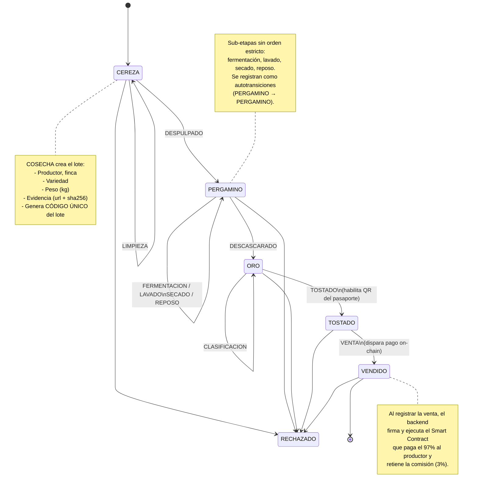

### Reglas de negocio de transición (tabla de transiciones)

> **Cadena completa con autotransiciones.** Los **hitos** (estados) son `CEREZA → PERGAMINO → ORO → TOSTADO → VENDIDO` (+ `RECHAZADO`). Cada **hito** admite **sub-etapas** que se registran como **autotransiciones** (el estado no cambia, pero queda evidencia en el historial).

| Transición | TipoEvento | Acción obligatoria | Campos verificados |
|---|---|---|---|
| `→ CEREZA` | `COSECHA` | Crea el lote (agregado) | `variedad`, `peso_kg`, `evidencia_url`, `evidencia_sha256`, `actor_id` |
| `CEREZA → CEREZA` | `LIMPIEZA` | Limpieza en fruta | `peso_kg`, `actor_id` |
| `CEREZA → PERGAMINO` | `DESPULPADO` | Despulpado del fruto | `merma_pct`, `peso_kg`, `metodo_beneficiado` (lavado/semilavado/honey/natural), `metodo_fermentacion`, `actor_id` |
| `PERGAMINO → PERGAMINO` | `FERMENTACION` | Fermentación controlada | `metodo_fermentacion`, `horas`, `pH`/`Brix` (opcional), `actor_id` |
| `PERGAMINO → PERGAMINO` | `LAVADO` | Lavado del pergamino | `peso_kg`, `actor_id` |
| `PERGAMINO → PERGAMINO` | `SECADO` | Secado (patio/mecánico) | `humedad_inicial_pct`, `humedad_final_pct`, `metodo_secado`, `actor_id` |
| `PERGAMINO → PERGAMINO` | `REPOSO` | Reposo/descanso del pergamino | `dias`, `actor_id` |
| `PERGAMINO → ORO` | `DESCASCARADO` | Descascarado → café verde | `peso_kg`, `merma_pct`, `actor_id` |
| `ORO → ORO` | `CLASIFICACION` | Clasificación y control de calidad | `puntaje_sca`, `defectos`, `densidad`, `tamiz`, `actor_id` |
| `ORO → TOSTADO` | `TOSTADO` | Tostado en planta | fecha de tostado (`registrado_en`), `actor_id` |
| `TOSTADO → VENDIDO` | `VENTA` | Registro de precio/venta | `monto_total`, `comprador_id`, `tx_hash` |
| `cualquier → RECHAZADO` | `RECHAZADO` | Descarte del lote | motivo, `actor_id` |

**Invariantes de negocio (prohibiciones)**:
- No se puede **saltar hitos** (`CEREZA → ORO` = error): cada cambio de hito debe pasar por el intermedio.
- Las **sub-etapas** solo se registran dentro de **su hito** (`CLASIFICACION` solo en `ORO`, `SECADO` solo en `PERGAMINO`, etc.) pero **sin orden estricto** entre ellas.
- **No hay retroceso después de `TOSTADO`** (irreversible físicamente): `VENDIDO` es terminal y `RECHAZADO` es absorbente.
- La merma nunca puede ser negativa.
- Cada evento registra quién lo hizo (`actor_id`) y un `timestamp` con zona horaria (UTC).
- **Append-only**: la historia no se reescribe jamás.
- **Hash determinista**: el hash de la cadena se calcula en orden (`registrado_en`, `id`) — ver §8 y ADR-11.

### Diseño orientado a objetos (OOP) — el corazón del dominio

> **¿Por qué OOP?** El problema de Bean Trust es un **modelado de dominio rico**: el Lote no es un simple registro, es un objeto que **tiene un ciclo de vida**, **valida sus propias transiciones** y **emite su certificado y su pago**. Modelarlo con objetos nos permite que esas reglas vivan **junto a los datos** (encapsulamiento) y no dispersas en scripts.

Qué beneficios concretos logramos con OOP aquí (basado en la skill de Python + patrón de dominio DDD):

1. **Encapsulación**: el `Lote` conoce su historia y *no se deja engañar* de pasar de CEREZA a ORO directo. Quien lo invoca simplemente pide "avanzar", el objeto valida o lanza error.
2. **Inmutabilidad de eventos**: `LoteEvento` es un **value object inmutable**: se crea y nunca se modifica. Esto es lo que hace verificable la trazabilidad (mismo principio que el append-only en BD).
3. **Polimorfismo controlado** para los estados: cada estado (`CerezaState`, `PergaminoState`, …) puede tener su propia lógica de validación de salida. Se gestiona con la **StateMachine** (patrón *State*), no con `if/case` gigantes en la API.
4. **Inversión de dependencias (DI)**: el servicio de aplicación depende de **interfaces** (`RepositorioLote`, `GatewayPagos`), no de Supabase ni de Polygon directamente → cambios de infraestructura no tocan la lógica.

**Buenas prácticas OOP de la skill Python aplicadas a este dominio:**

| Skill (buena práctica) | Cómo se aplica en Bean Trust |
|---|---|
| **Pydantic para las fronteras (schemas)** | El `Lote` de dominio es una clase normal (o `@dataclass`); los `LoteCreate`/`EventoCreate` con Pydantic validan **en el router** la entrada/salida. No se mezcla validación de transporte con lógica de negocio. |
| **Value object inmutable (`frozen=True`)** | `LoteEvento` se define `@dataclass(frozen=True)`: se crea, se lee, jamás se modifica → la historia no puede ser alterada ni reordenada. (Gotcha de la skill: `dataclass` para structs internos, Pydantic solo en las fronteras API.) |
| **`Enum` en vez de strings mágicos** | `Estado` y `TipoEvento` son `enum.Enum` de Python: el compilador/linter atrapa typos y solo permite valores válidos en `MaquinaEstados`. |
| **Cuidado con `bool` como subclase de `int`** | Al validar `esTransicionValida(...)` nunca se compara con `== True`, se usa `is` o se tipa `bool` explícitamente en la firma (gotcha de la skill). |
| **`Depends` de FastAPI para DI** | Los repositorios/gateways (`SupabaseLoteRepo`, `GatewayPagos`) se inyectan con `Annotated` + `Depends` (skill de FastAPI). El dominio habla solo contra interfaces → testeable con mocks. |
| **Sin `dicts` desnudos** | Todo lo que cruza la frontera va en modelos Pydantic tipados; el dominio nunca recibe `dict.get("x")` que puede fallar en silencio (gotcha de la skill). |

**Diagrama de clases (OOP):**

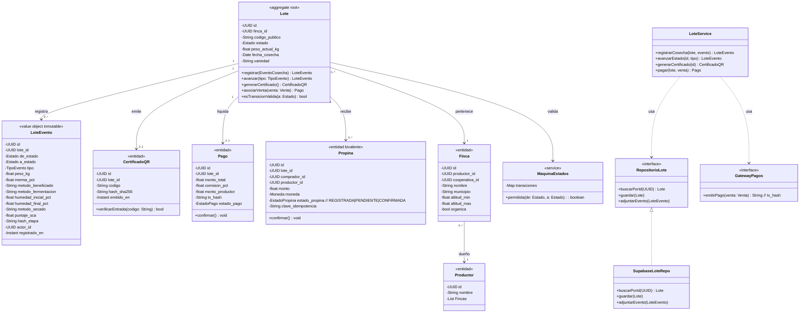

> **`TipoEvento` (enum ampliado):** `COSECHA` · `LIMPIEZA` · `DESPULPADO` · `FERMENTACION` · `LAVADO` · `SECADO` · `REPOSO` · `DESCASCARADO` · `CLASIFICACION` · `TOSTADO` · `VENTA` · `RECHAZADO` (12 valores: 11 transiciones + rechazo). Las sub-etapas (`LIMPIEZA`, `FERMENTACION`, `LAVADO`, `SECADO`, `REPOSO`, `CLASIFICACION`) son **autotransiciones**: `de_estado == a_estado`.

> **Nota de implementación:** este diagrama es **conceptual** (CamelCase). En el código los nombres son snake_case (`LoteService` = `LoteService`, `RepositorioLote` = `lote_repo`, `QrService` = `qr_service`), los repos son protocolos en `app/repositories/` y la entidad `Productor` es la columna `rol`/FK de `Usuario` (véase la nota del ERD en §5).

**Por qué cada elemento:**

| Clase | Por qué existe | Principio OOP |
|---|---|---|
| `Lote` (aggregate) | Única identidad raíz que garantiza consistencia de datos | Aggregate + Encapsulación |
| `LoteEvento` | La historia es **inmutable**: es la evidencia de trazabilidad | Inmutabilidad / Value Object |
| `Estado` (enum + clases State) | Máquina de estados encapsulada; evita transiciones ilegales | Patrón State |
| `MaquinaEstados` | Define la tabla de transiciones como **declarativa** (un mapa, no if/case) | OCP (abierto a extensión) |
| `RepositorioLote` (interfaz) | El dominio no depende de la BD (Supabase es un detalle) | Dependency Inversion |
| `GatewayPagos` (interfaz) | El dominio no sabe cómo se paga (Polygon es un detalle) | Dependency Inversion |
| `Propina` | Comprador → productor, 100% directo, idempotente y bivalente | Entidad + Idempotencia (ADR-10) |
| `Finca`, `Productor` | Entidades de contexto on-farm que el Certificado de Origen debe exhibir | Bounded Context (origen) |
| Services | Separación: los rout​ers no hacen lógica; los services deciden el "qué" | Single Responsibility |

> **`EventoCosecha` y `Venta` no son entidades de dominio**: son **schemas Pydantic** (DTOs de entrada) que cruzan la frontera de la API; el dominio los recibe, los valida y los convierte en `LoteEvento` / `Pago`. No tienen tabla propia.

> Esta estructura OOP se traduce, en FastAPI, a módulos del skill (services, schemas, repositories) y en la BD a las tablas de §5. **No es una sobre-ingeniería**: son 5–6 clases de dominio que dan integridad al problema central (no dar falsos certificados).

---

## 5. Modelo de base de datos (PostgreSQL / Supabase)

### Principio central: Estado actual + historial inmutable

- **`lotes`**: una fila con el **estado actual** (denormalizado) → lecturas rápidas de panel y QR.
- **`lote_eventos`**: **append-only**, almacena cada transición como un evento inmutable → evidencia de trazabilidad.

Este patrón de *event-sourcing ligero* es lo que permite probar la certificación: la historia nunca se edita.

### Diagrama Entidad-Relación (ERD)

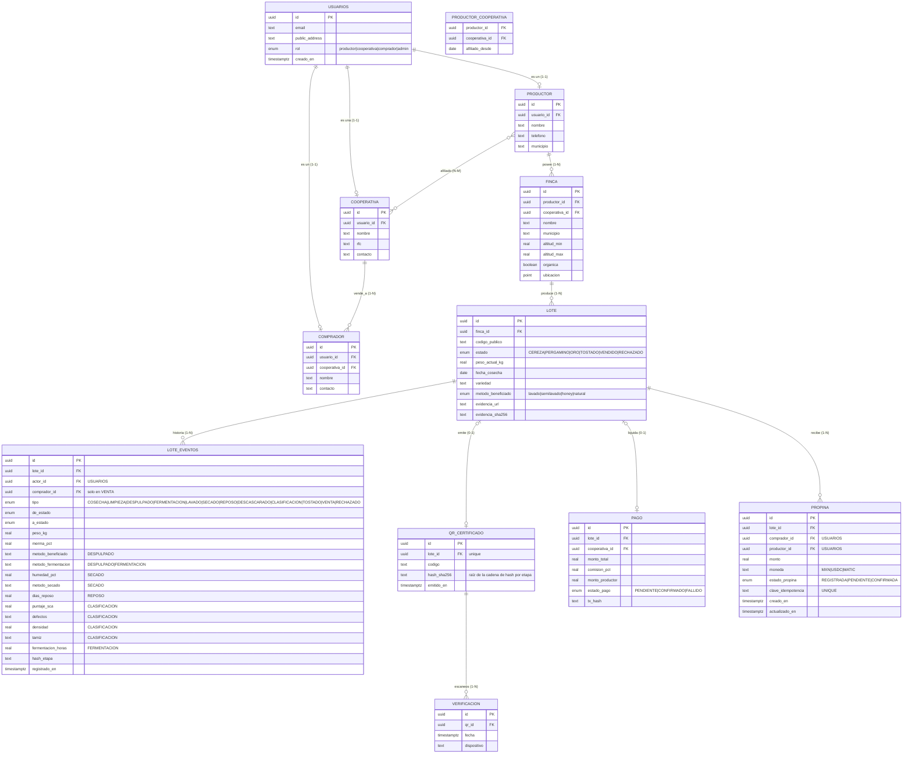

> **Desviaciones implementadas en el v1 MVP (vs. ERD completo):**
> - No existen tablas `PRODUCTOR`, `COOPERATIVA`, `COMPRADOR` ni `PRODUCTOR_COOPERATIVA` como tablas propias. El rol y la entidad vinculada viven en `USUARIOS` (columna `rol` + FK `finca_id`/`cooperativa_id`/`comprador_id`); `FINCA.productor_id` referencia directamente `USUARIOS`. Se simplifica el modelo para el MVP y se documenta la migración futura (B7/B11).
> - `USUARIOS.public_address` (wallet) **no se persiste aún**: depende del milestone de contratos (B11) y de la integración web3 (pausada).
> - `VERIFICACION` usa `lote_id` + `verificado_en` en vez de `qr_id` + `fecha`: un QR certifica un lote 1-1, por lo que el escaneo se ancla al lote directamente.
> - `LOTE.codigo_publico` no existe como columna: el código público de verificación vive en `QR_CERTIFICADO.codigo`.
> - Las PK UUID se generan en el cliente (offline-first), no con `gen_random_uuid()`.
> - El índice real es `idx_lote_eventos_lote` (véase `001_esquema_inicial.sql`).

### Diagrama Entidad-Relación conceptual (notación Chen)

> Versión **didáctica** del modelo (como la del ejemplo de referencia): destaca *entidades* (rectángulo), *relaciones* (rombo) y *cardinalidades* (1:1, 1:N, N:M) **sin** detallar columnas. Su objetivo es validar la lógica de negocio (¿quién se relaciona con quién y cuántos?) antes de aterrizar en el modelo físico de la § anterior.

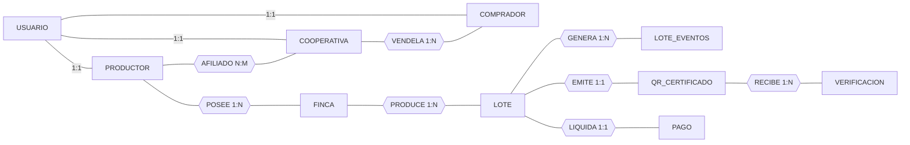

> **Lectura del modelo conceptual:**
> - `USUARIO → PRODUCTOR/COOPERATIVA/COMPRADOR` son relaciones **1:1**: una cuenta del sistema es exactamente una de esas tres figuras (rol vive en la tabla `USUARIOS.rol`).
> - `PRODUCTOR` **posee** muchas `FINCA`s (1:N); cada finca pertenece a un solo productor.
> - Una `COOPERATIVA` **vende** su café a varios `COMPRADOR`es (**1:N**); el `COMPRADOR` lleva `cooperativa_id` como FK.
> - `PRODUCTOR` está **afiliado** a varias `COOPERATIVA`s y viceversa (**N:M**) → se materializa con la tabla puente `PRODUCTOR_COOPERATIVA`.
> - `FINCA` **produce** muchos `LOTE`s y cada lote **genera** muchos `LOTE_EVENTOS` (1:N).
> - Cada `LOTE` **emite como mucho un** `QR_CERTIFICADO` y **liquida como mucho un** `PAGO` (1:1 "baja": 0 o 1) — coincide con el ERD.
> - `LOTE_EVENTOS`, `QR_CERTIFICADO`, `VERIFICACION` y `PAGO` son **entidades débiles**: solo tienen sentido ligadas a su lote/origen.

> **De lo conceptual a lo físico (`erDiagram` de arriba):** las relaciones 1:1/1:N se resuelven con una **FK** en la entidad del lado "N"; las N:M requieren una **tabla intermedia** (`PRODUCTOR_COOPERATIVA`). Los diseños por Issue 1–5 se consolidaron en este documento y en `docs/06-contratos.md`.

### Diagrama de flujo de datos (DFD) — de dónde viene cada dato

> El ERD muestra *qué* hay; este diagrama muestra *de dónde viaja cada dato* hasta la base y *quién lo consume*. Antes de guardar datos hay que saber quién los crea y quién los usa.

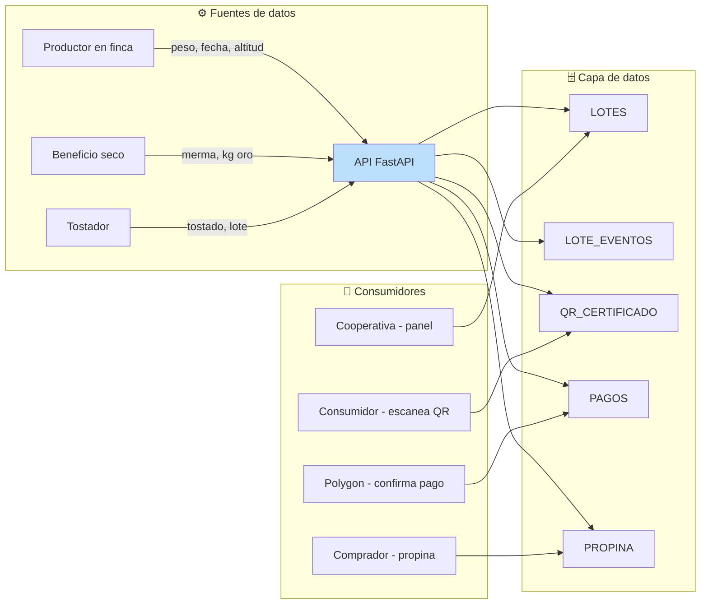

### Diagrama de dominio (Clase) — de quién es responsable de cada dato

> El **diagrama de clases del dominio** es el de §4 (única fuente de verdad). Esta sección solo indica cómo se traduce a las tablas de la base de datos.

| Clase (dominio §4) | Tabla(s) | Mapeo |
|---|---|---|
| `Lote` | `LOTE` | 1 fila = 1 lote (estado denormalizado + variedad + evidencia) |
| `LoteEvento` | `LOTE_EVENTOS` | 1 evento = 1 transición/sub-etapa (append-only, `hash_etapa`) |
| `CertificadoQR` | `QR_CERTIFICADO` | emitido al llegar a `TOSTADO` (0–1 por lote); `hash_sha256` = raíz de la cadena |
| `Pago` | `PAGO` | creado al vender (0–1 por lote) |
| `Propina` | `PROPINA` | 0–N por lote; bivalente off-chain/on-chain |
| `Finca` / `Productor` | `FINCA` / `PRODUCTOR` | contexto de origen del lote |
| `SupabaseLoteRepo` | infraestructura | lee/escribe las tablas anteriores |
| `LoteService`, `MaquinaEstados` | servicios (no tablas) | reglas de negocio |

> **Hash por etapa (cadena lineal).** Cada `LOTE_EVENTOS.hash_etapa` se calcula como `HASH(etapa_anterior.hash_etapa ‖ datos_del_evento)` en orden `(registrado_en, id)`. El último hash de la cadena **es la raíz** guardada en `QR_CERTIFICADO.hash_sha256`. Si se edita un evento, la raíz deja de coincidir → 409 (ver §8 y ADR-11).

> Reglas de cardinalidad alineadas entre §4 y este ERD: un lote **tiene como mucho un** QR y **un** pago, porque la certificación (`TOSTADO`) y la venta (`VENDIDO`) solo ocurren una vez terminalmente.

### ¿Por qué se guarda cada dato? (Pregunta de negocio → Dato)

> No guardamos nada "porque sí". Cada dato responde a una pregunta concreta de negocio o a una exigencia regulatoria de la memoria.

| Pregunta de negocio | Dato que guardamos | Tabla |
|---|---|---|
| ¿Quién cultivó este lote? | `productores.*`, `fincas.*` | PRODUCTOR / FINCA |
| ¿Dónde creció? (certificar origen) | `municipio`, `altitud_min/max`, `organica` | FINCA |
| ¿Qué variedad es? | `variedad` | LOTE |
| ¿Cuánto café se registró? | `fecha_cosecha`, `peso_kg` | LOTE |
| ¿Cómo se benefició? | `metodo_beneficiado` (lavado/semilavado/honey/natural) | LOTE / LOTE_EVENTOS |
| ¿En qué etapa está? | `estado` → `LOTE` (denorm) | LOTE |
| ¿Cómo fue su historia? (trazabilidad) | `LOTE_EVENTOS` record con de/a estado + sub-etapas | LOTE_EVENTOS |
| ¿Se perdió peso en cada proceso? | `merma_pct` | LOTE_EVENTOS |
| ¿Cuánto fermentó / se secó / reposó? | `fermentacion_horas`, `humedad_pct`, `dias_reposo` | LOTE_EVENTOS |
| ¿Qué calificación de taza tiene? | `puntaje_sca`, `defectos`, `densidad`, `tamiz` | LOTE_EVENTOS |
| ¿La evidencia fotográfica existe? | `evidencia_url` + `evidencia_sha256` | LOTE |
| ¿La cadena es íntegra? | `hash_etapa` por evento; raíz en `hash_sha256` | LOTE_EVENTOS / QR_CERTIFICADO |
| ¿Toda la información es inmutable? | `registrado_en` + solo INSERT | LOTE_EVENTOS |
| ¿Quién hizo cada transición? | `actor_id` → `USUARIOS` | LOTE_EVENTOS / USUARIOS |
| ¿Quién escaneó el QR? | `VERIFICACION` (fecha, dispositivo) | VERIFICACION |
| ¿Cuánto paga al productor? | `monto_total`, `monto_productor`, `comision_pct` | PAGO |
| ¿Quién compró el lote? | `comprador_id` en el evento `VENTA` | LOTE_EVENTOS |
| ¿El pago llegó on-chain? | `tx_hash`, `estado_pago` | PAGO |
| ¿El comprador dejó una propina? | `monto`, `moneda`, `estado_propina`, `clave_idempotencia` | PROPINA |
| ¿Es una persona/org con credenciales? | `email`, `rol`, `public_address` (wallet) | USUARIOS (wallet pendiente, B11) |
| ¿El QR es auténtico? | `hash_sha256` (raíz de la cadena por etapa) | QR_CERTIFICADO |

---

### Buenas prácticas PostgreSQL (aplicadas desde el inicio)

- **ENUM** para `estado` y `tipo` (no VARCHAR suelto) → evita estados inválidos en BD.
- **`TIMESTAMPTZ`** en todas las fechas (UTC): nunca `TIMESTAMP` sin zona.
- **CHECK constraints**: `merma_pct >= 0`, `peso_kg > 0`, `comision_pct BETWEEN 0 AND 100` → la integridad se valida también en la base, no solo en la API.
- **UUID** como PK (generado en cliente) → admite ids generados offline sin colisiones; el servidor nunca asume que el id llega "vacío".
- **`lote_eventos` inmutable**: sin UPDATE/DELETE, solo INSERT.
- Índice para consultar la historia en orden:
  `CREATE INDEX idx_lote_eventos_lote ON lote_eventos (lote_id, registrado_en DESC);`
- **RLS**: las políticas se anclan a `auth.uid()` → `USUARIOS` (rol + entidad vinculada), nunca a un ID enviado por el cliente.

---

## 6. API contrato (FastAPI) — detalle por endpoint

> El backend es la única puerta que conoce las **reglas de negocio del café**: valida la máquina de estados, genera QR y despacha los pagos. La app solo le pide y le entrega datos; **nunca** escribe directo a la base.

### Capas del backend (lógica de responsabilidades)

```
┌───────────────────────────────────────────────────────────┐
│ 1. Capa de presentación (routers)                          │
│    - Expone los endpoints REST (/lotes, /eventos, ...)     │
│    - Recibe el request y entrega la respuesta como DTO   │
│    - No sabe cómo se procesa un evento                   │
├───────────────────────────────────────────────────────────┤
│ 2. Capa de aplicación (servicios de orquestación)          │
│    "Servicios": decide QUÉ hacer                          │
│    - maquina_estados: ¿es válida esta transición?         │
│    - lotes_service: coordina crear/evento/consulta        │
│    - qr_service: arma y firma el certificado QR           │
│    - payments: orquesta el pago on-chain (3%/97%)         │
│    Es la única capa que CONOCE las reglas de negocio       │
├───────────────────────────────────────────────────────────┤
│ 3. Capa de acceso a datos (repository)                        │
│    - Traduce las peticiones a queries de Supabase         │
│    - lote_eventos: SOLO INSERT (append-only)              │
│    - lotes: UPDATE del estado actual (denorm)              │
├───────────────────────────────────────────────────────────┤
│ 4. Capa de infraestructura                                     │
│    - Supabase client (pool)                                  │
│    - Web3 client (nodo Polygon)  → firma y envía tx          │
│    - Secrets en variables de entorno (nunca en código)      │
└───────────────────────────────────────────────────────────┘
```

### Reglas que garantizan la separación

- Una capa **no puede** saltarse a la interior (router no escribe SQL). Si lo hace, se rompe la inmutabilidad de la trazabilidad.
- Los services concentran el **"qué"**; la infraestructura el **"cómo"**. Swaps de BD o de red no afectan la regla de estados.
- Respuesta siempre con DTO de salida (sin campos internos ni claves).

### Puntos de entrada (endpoints)

**Diseño de la API (buenas prácticas REST aplicadas con la skill FastAPI):**

| Método | Ruta | Qué hace | Idempotencia | Códigos |
|---|---|---|---|---|
| `POST` | `/v1/lotes` | Crear lote en estado CEREZA (variedad, método, peso, evidencia) | No (da id) | `201` · `400` · `422` |
| `POST` | `/v1/lotes/{id}/eventos` | Registrar transición/sub-etapa (11 tipos) | `Idempotency-Key` | `201` · `409` · `422` |
| `GET` | `/v1/lotes/{id}` | Consultar lote + historial | Sí | `200` · `404` |
| `GET` | `/v1/lotes` | Listar lotes (paginado por cursor) | Sí | `200` · `400` |
| `GET` | `/v1/verificar/{codigo}` | **Pasaporte de Café** público (sin auth) | Sí | `200` · `404` · `409` |
| `GET` | `/v1/pagos` | Consultar pagos (lectura) | Sí | `200` |
| `GET` | `/v1/pagos/saldo` | Saldo/estado del productor | Sí | `200` |
| `POST` | `/v1/propinas` | Registrar propina del comprador (idempotente, bivalente) | `Idempotency-Key` | `201` · `409` · `422` |
| `GET` | `/v1/me` | Perfil del usuario autenticado | Sí | `200` |
| `POST` | `/v1/sync` | Batch de operaciones offline | Sí (reusa ids) | `202` · `207` |
| `POST` | `/v1/auth/login` | Login (JWT de Supabase) | No | `200` · `401` |
| `POST` | `/v1/auth/refresh` | Renovar token | No | `200` · `401` |
| `GET` | `/v1/cooperativas` | Listar cooperativas (admin) | Sí | `200` · `403` |

**Notas de alcance:**
- **Estado del Día** es un widget **decorativo** del dashboard: se computa en el cliente desde datos ya disponibles; **no tiene endpoint** propio (ADR-13).
- **Mercado** es una **proyección de solo lectura** (`GET`): se materializa desde el backend, la app nunca lo escribe (ADR-9).
- El comprador lee pagos/propinas (`GET /v1/pagos`, `POST /v1/propinas`) y el productor ve su saldo (`GET /v1/pagos/saldo`); `GET /v1/me` resuelve el rol real desde `USUARIOS` por `auth.uid()`.

**Reglas aplicadas:**
- Recursos en plural (`/lotes`, `/eventos`); anidamiento solo en jerarquías reales (`/lotes/{id}/eventos`).
- Las transiciones y pagos son **acciones** → `POST`, no `PUT` de estado; se usa `Idempotency-Key` para que un retry offline no duplique el evento.
- Nada de `DELETE` en trazabilidad: lo físico se "cancela" con el estado `RECHAZADO` (se conserva la historia).
- Versionado por URL (`/v1/`): los teléfonos en campo no se actualizan el mismo día; la versión vieja de la API debe seguir viva.
- Paginación por cursor (`?cursor=..&limit=..`) en vez de `OFFSET` (evita escaneos lentos en tablas grandes).
- Códigos 2xx con semántica correcta: `200` (lectura), `201` (creado), `202` (pago asíncrono on-chain), `207` (multi-status en sync).

### Flujo de una transición (diagrama de secuencia)

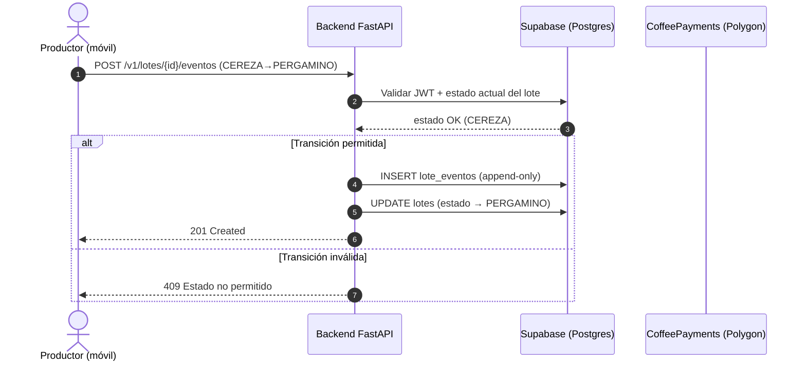

> La app **nunca** escribe directo a la BD: todo pasa por FastAPI, que valida JWT y la máquina de estados. La app en modo offline guarda en su SQLite local y sincroniza después (ver §7).

### Idempotencia y append-only (diagrama)

Los eventos y pagos usan la cabecera `Idempotency-Key` (UUID generado por el móvil). Ese UUID **es el PK** del evento en `lote_eventos`, de modo que reenviar la misma operación (retry offline, doble tap) **no duplica** el historial: el servidor detecta la clave y devuelve el lote tal como quedó.

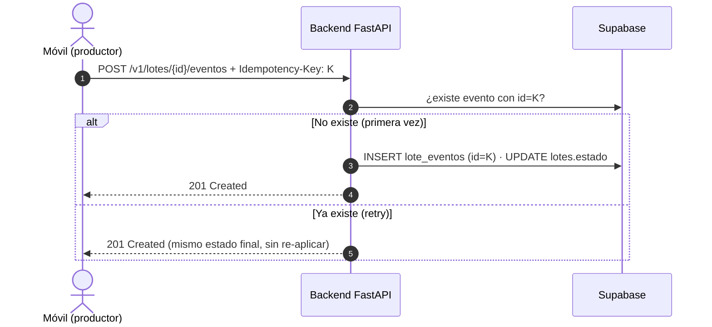

- `lote_eventos` es **append-only**: su repositorio solo expone `insert`/`select` y la BD bloquea `update`/`delete` con trigger (migración 003).
- El mismo mecanismo aplica a los pagos y propinas: `pago.idempotency_key` y `propina.clave_idempotencia` son `UNIQUE` (§5), de modo que reenviar una venta o una propina no dispara dos efectos.
- En el sync (`POST /v1/sync`) cada operación lleva su propio `id`; por eso es seguro reenviar el batch completo (202) aunque algunas ya se hayan aplicado. Si alguna operación del batch no se pudo aplicar (conflicto de estados, error de dominio o error interno) se responde `207` con el detalle por `op_id`; el cliente solo reenvía las no aplicadas.

### Validación de entrada / salida (Pydantic)

- Todo `body` pasa por modelos Pydantic: tipos fuertes, límites (`Field(gt=0)`) y enum de estados.
- Toda respuesta usa `response_model` / tipo de retorno para no exponer campos internos (ej. claves privadas).
- Errores de negocio: HTTP 422 (validación) o 409 (estado inválido), mensajes en español.

---

## 7. Aplicación móvil (React Native / Expo) — lógica

> La app es la **cara del productor en campo**: registrar cosechas con 3 toques, ver el estado de cada lote y generar su QR. Está pensada para usarse bajo el sol y sin conexión.
> Buenas prácticas aplicadas de las skills oficiales: **vercel-react-native-skills** (índices de rendimiento, navegación, UI) y **react-native-best-practices** (performance, perfilado).

### 7.1 Responsabilidades de la app (lógica)

| Responsabilidad | Qué hace | ¿Dónde vive? |
|---|---|---|
| Registrar cosecha/eventos | Captura en campo, valida en el dispositivo | Pantallas + formularios |
| Lógica offline | Escribe primero en SQLite local, encola y sincroniza | Subcapa `db` + `sync` |
| Ver el historial de un lote | Muestra la máquina de estados de forma visual | Pantalla de detalle |
| Escanear / mostrar QR | Generación y verificación con el consumidor | Pantalla de QR |
| Autenticación | Login/refresh con Supabase Auth (JWT) | Subcapa auth |

### 7.2 Capas internas de la app (sin código)

```
┌───────────────────────────────────────────────┐
│ Pantallas (expo-router, 4 tabs + stacks)       │
│   Cosecha (tab): lotes/ (lista) + stack        │
│   Dashboard (tab): Mi Finca (bento grid)       │
│   Trazabilidad (tab): historial de mis lotes      │
│     (el escáner público vive en verificar/)       │
│   Mercado (tab): ofertas + mercado/[loteId]     │
│   Ajustes (tab): perfil, sync, sesión           │
│   Grupo PÚBLICO verificar/: index (escáner)     │
│     + [codigo] (Pasaporte de Café, sin auth)    │
├───────────────────────────────────────────────┤
│ Estado de UI (Zustand / Jotai)                 │
│   - loteStore (estado actual del lote en cache)│
│   - syncStore (contador, pendientes, errores)  │
│   - offlineStore (lecturas cacheadas + alerta) │
├───────────────────────────────────────────────┤
│ Repositorio local (SQLite)                     │
│   - lecturas SIEMPRE desde el local (caché)    │
│   - cola de operaciones pendientes (sync_queue)│
├───────────────────────────────────────────────┤
│ Cliente de red (HTTP a FastAPI)              │
│   - envía operaciones online o en lote         │
│   - autentica con JWT de Supabase              │
└───────────────────────────────────────────────┘
```

### 7.3 Navegación y flujo de pantallas

- **Navegación nativa** (expo-router con native stack/tabs) según la skill Vercel (evitar JS navigators por rendimiento y comportamiento de plataforma).
- **4 tabs autenticadas**: **Cosecha** (registro + detalle), **Dashboard Mi Finca** (resumen bento), **Mercado** (ofertas/proyección), **Ajustes** (perfil y sync).
- **Stack por tab**:
  - `lotes/` (lista) → `lotes/nuevo` (**wizard de 3 pasos**: 1) variedad + método → 2) peso → 3) evidencia fotográfica) → `lotes/[id]` (detalle con **timeline hash por etapa**).
  - `mercado/` → `mercado/[loteId]` (**Panel Comercio Justo**: donut 97/3 + propina).
- **Grupo PÚBLICO `verificar/` fuera del auth**: `verificar/` (escáner) → `verificar/[codigo]` (Pasaporte de Café). El consumidor final no inicia sesión.
- **Dashboard Mi Finca** (tab): layout **bento** con tarjetas (lotes activos, saldo, Estado del Día decorativo) + **alerta offline** persistente cuando no hay conexión + **FAB** flotante que lleva al wizard `lotes/nuevo`.

```mermaid
flowchart LR
    subgraph AUTH["🔐 Autenticadas (4 tabs)"]
        T1[Cosecha] --> W[Wizard nuevo lote<br/>1 variedad+método → 2 peso → 3 evidencia]
        T1 --> D[Detalle lote [id]<br/>timeline hash por etapa]
        T2[Dashboard Mi Finca<br/>bento + alerta offline + FAB]
        T3[Mercado] --> P[Panel Comercio Justo<br/>donut 97/3 + propina]
        T4[Ajustes]
    end
    subgraph PUB["🌐 Público (sin auth)"]
        S[verificar/ escáner] --> PAS[verificar/[codigo]<br/>Pasaporte de Café]
    end
    Login --> AUTH
    T1 --> Login
    S --> PAS
```

**Paleta "Copa de cata"** (identidad visual): espresso `#3A1D0C` (fondos/acentos fuertes), crema `#8A5A00` (CTAs y acentos), cereza `#8A2E3D` (alertas y destinos), superficie `#F7EBDD` (fondos claros y tarjetas).

### 7.4 Rendimiento y experiencia en campo (skills oficiales)

- **Listas** de lotes/historial: lista virtualizada (FlashList), nunca `ScrollView` con `map` — los teléfonos de campo son baratos y en memoria viven los datos.
- **Re-render**: estado atómico con selectores (Zustand) en vez de un contexto global enorme.
- **UI en campo**: controles grandes, alto contraste, guardar con un solo botón; íconos claros (memoria: alfabetización digital variada).
- **Perfilado antes de optimizar**: medir (react-devtools/profilares), optimizar, re-medir — evita memoización a ciegas.

### 7.5 Módulo offline-first (mobile ↔ backend)

> Problema real: en la sierra no hay conectividad. La app debe funcionar **sin internet** y sincronizar después.
> Esto es parte de la capa `db` + `sync` de la app (ver §7.2).

```
App Mobile (Expo)
   ● ¿Hay conexión?  (NetInfo)
   ├── sí ──► SQLite local como caché de lecturas + envía operaciones
   │           y las marca como "sincronizadas"
   └── no ──► SQLite local: guarda eventos y encola la operación
              en la sync_queue

Al reconectarse (NetInfo / reintento con backoff) -->
   POST /v1/sync  (batch de operaciones pendientes)
   el backend procesa y responde resultado por operación
   la app marca cada una como 'ok' o 'conflicto' (LWW)
```

#### Decisiones clave de diseño (offline)

| Decisión | Regla |
|---|---|
| Ids | UUID generados **en el móvil** (evita conflicto de llaves primarias) |
| Cola local | Tabla `sync_queue` (operación tipada + payload + estado) |
| Lecturas | Siempre desde SQLite local → la UI nunca "se congela" |
| Reintentos | Backoff exponencial + notificación al reconectar |
| Conflictos | LWW (*last-write-wins*) por `updated_at` |
| Integridad | `lote_eventos` del servidor SIEMPRE es la fuente de verdad |

#### Secuencia de sincronización

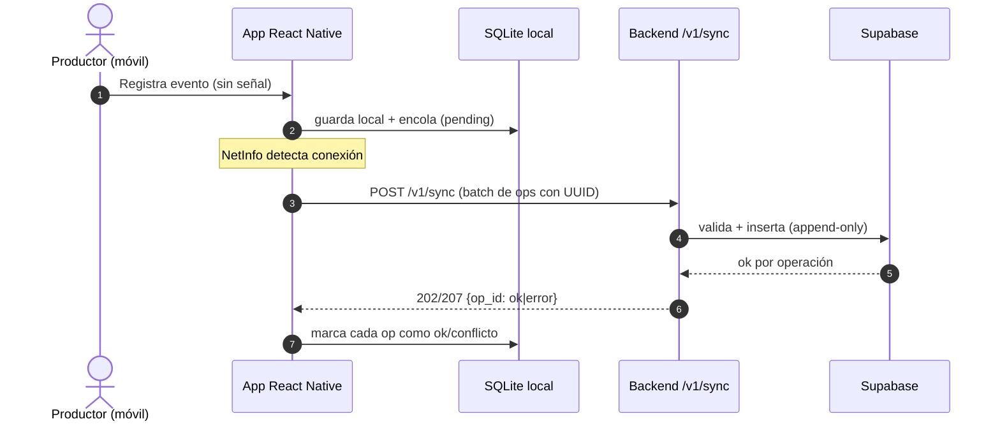

---

## 8. Pasaporte de Café (verificación pública QR)

> Todo este sistema converge en un único artefacto para el consumidor: el **Pasaporte de Café** (evolución del Certificado de Origen) emitido a través de un código QR. "Verificar el café" significa comprobar que el origen y los procesos declarados realmente ocurrieron.

- El QR codifica el `codigo` + `hash_sha256` raíz del lote (no expone todo el historial en el propio QR; lo trae la API al validar).
- El pasaporte exhibe **datos ricos de trazabilidad**: productor, finca (municipio + altitud), **variedad**, **método de beneficiado**, fecha de cosecha, **humedad final**, **puntaje SCA**, estado actual e historial de procesos como **timeline con hash por etapa** (CEREZA → PERGAMINO → ORO → TOSTADO, incluyendo sub-etapas).
- Al escanear → `GET /v1/verificar/{codigo}` (sin autenticación).
- Respuestas:
  - **Válido**: el Pasaporte de Café con datos del lote + timeline de eventos con su `hash_etapa`.
  - **No encontrado** → HTTP 404.
  - **Inválido/tampered** → HTTP 409.
- La **integridad se corta por `emitido_en`**: los eventos posteriores a la emisión del certificado **no** forman parte del hash canónico verificado (el pasaporte es una foto del lote al emitirse). El hash por etapa permite además el anclaje on-chain (§9, ADR-11).

### Flujo de verificación (diagrama de secuencia)

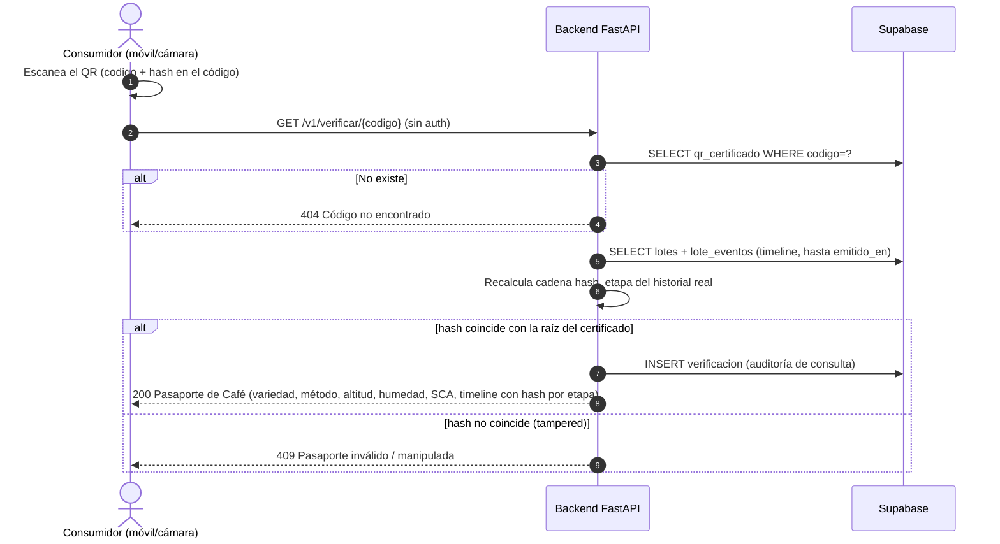

### Escaneo móvil → Pasaporte (grupo público, sin auth)

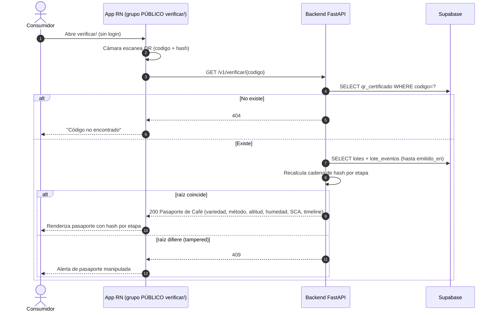

> El grupo `verificar/` vive **fuera del auth** en el router: el consumidor final escanea sin crear cuenta (§7.3).

---

## 9. Blockchain y pagos (Solidity / Polygon)

> **Estado v1 MVP**: el flujo on-chain está **diseñado** aquí y en `docs/06-contratos.md`, pero la integración web3 está **en pausa** (falta proyecto Supabase real y wallet del backend). En el código se ejecuta `FakeGatewayPagos` (tx determinista `0x<pago.id>` y confirmación simulada) que ya implementa el patrón 3%/97% y el poller `PENDIENTE → CONFIRMADO`. La wallet del productor (`public_address` en `USUARIOS`) se persistirá cuando se retome B11.

### Responsabilidad del Smart Contract `CoffeePayments.sol`

Responsabilidad exclusiva: el pago y la inmutabilidad de la transacción (*única responsabilidad*).
- Recibe la venta (`lote_id`, `productor`, `cantidad` → `peso_kg` del evento `VENTA`, `precio` → `monto_total`) **firmada por el backend**.
- Retiene el **3% de comisión** hacia la tesorería de la cooperativa.
- Envía el **97%** automáticamente a la wallet del productor (patrón *pull-over-push*).
- Emite eventos on-chain (`PaymentPaid(loteId, productorAddr, monto)`) para auditar.

### Buenas prácticas de la skill Solidity

- Solidity `0.8.x` (protección de overflow/underflow por el compilador).
- SafeERC20 + `ReentrancyGuard` (OpenZeppelin).
- Patrón *checks-effects-interactions*.
- Custom errors (más baratos en gas) en vez de `require("mensaje")`.
- La **llave privada del backend NUNCA está en el código**: se guarda como secreto de entorno (Supabase secrets / `.env`, que está en `.gitignore`).

### Red y despliegue

- **Testnet**: Polygon `Amoy` (testnet y compatibles actuales de Polygon).
- Deploy desde `contracts/script/` con **Foundry** (`forge script ... --rpc-url ...`).
- Fondos de prueba: faucet de Amoy (MATIC de prueba, gratis).
- En producción se evalúa Mainnet; Polygon (L2) mantiene gas bajo porque hereda seguridad de Ethereum.

> La especificación completa del contrato, el flujo y el estado de la
> implementación viven en **`docs/06-contratos.md`**. La implementación web3
> está **en pausa** (B7): el MVP corre con `FakeGatewayPagos`.

### Flujo de pago por el backend (diagrama de secuencia)

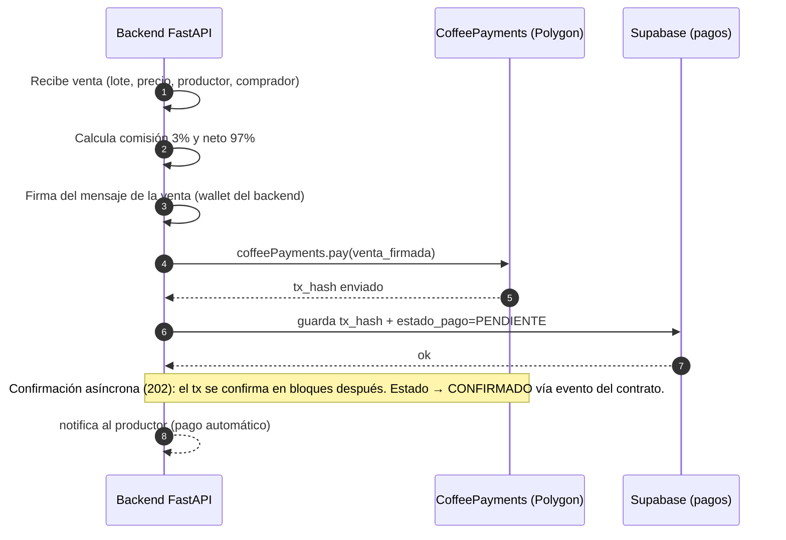

> Si el productor todavía no tiene wallet, se le asigna/genera una al registrarse: su `public_address` vive en la tabla **`USUARIOS`** (única fuente de verdad de la wallet). En campo (offline) la dirección se puede crear localmente y validarse al sincronizar.
> El pago se dispara desde la cuenta de la **cooperativa** (autor de la venta); el contrato envía el 97% a la wallet del productor y retiene el 3% hacia la tesorería de la cooperativa.

### Panel Comercio Justo (proyección read-only)

- El **Panel Comercio Justo** de `mercado/[loteId]` (donut **97/3** + desglose de comisión) es una **proyección de solo lectura** materializada por el backend desde `PAGO`/`PROPINA`; **no tiene escritura propia** (ADR-9).
- Es visible para **comprador** (lee comercio justo/propinas) y productor (su saldo); nunca expone la wallet del backend ni datos ajenos (RLS §10).

### Propina al productor (ADR-10)

- El comprador puede dejar una **propina** `POST /v1/propinas` con `clave_idempotencia` `UNIQUE` → **100% directo** al productor (sin comisión).
- **Bivalente off-chain/on-chain**: `PROPINA.estado_propina` (`REGISTRADA → PENDIENTE → CONFIRMADA`) avanza según la confirmación on-chain, igual que `PAGO`. Cuando la integración web3 se retome, la propina se liquida con el mismo mecanismo de firma.
- La interfaz de pago actual (`GatewayPagos` + `FakeGatewayPagos`) ya soporta la idempotencia; la propina reutiliza el patrón.

### Anclaje por etapa on-chain (ADR-11)

- Cada `LOTE_EVENTOS.hash_etapa` se puede anclar on-chain **reusando `anclarHash(hash)`** (función de anclaje del contrato): se ancla la **raíz** (`QR_CERTIFICADO.hash_sha256`) y opcionalmente hitos intermedios (PERGAMINO, ORO) para prueba de no-manipulación por etapa.
- Mismo mecanismo de la nota previa: **web3 en pausa** (B7) — se documenta y se retoma con la integración real.

---

## 10. Roles y permisos (Supabase RLS + JWT)

Los roles se modelan en la tabla **`USUARIOS.rol`** (`productor | cooperativa | comprador | admin`). El consumidor final **no tiene cuenta** en el sistema: verifica vía el endpoint público `/verificar` (sin token).

| Rol | Lectura | Escritura | ¿Cuenta? |
|---|---|---|---|
| **productor** | Sus fincas, sus lotes y su saldo (`/pagos/saldo`) | Eventos de sus lotes | Sí |
| **cooperativa** | Todos los lotes de sus fincas | Gestión de lotes, productores, pagos | Sí |
| **comprador** | Lotes verificables (QR público) **+ comercio justo/propinas** | Propinas sobre lotes vendidos | Sí |
| **consumidor** | Solo QR `/verificar` (público) | — | No |
| **admin** | Todo | Configuración, cooperativas | Sí |

- **Autenticación**: Supabase Auth (email/contraseña, o *magic link* para productores sin email). El `auth.uid()` de Supabase **es** el `USUARIOS.id` (mismo UUID vinculado al registrarse).
- **Autorización**: RLS en PostgreSQL — las políticas resuelven el rol desde `USUARIOS` y restringen por pertenencia (`PRODUCTOR` de la finca, `COOPERATIVA` de la finca) **sin confiar en IDs enviados por el cliente**; adicionalmente la dependencia `get_current_user` en FastAPI fuerza el mismo chequeo a nivel de API.

### Flujo de autenticación (diagrama de secuencia)

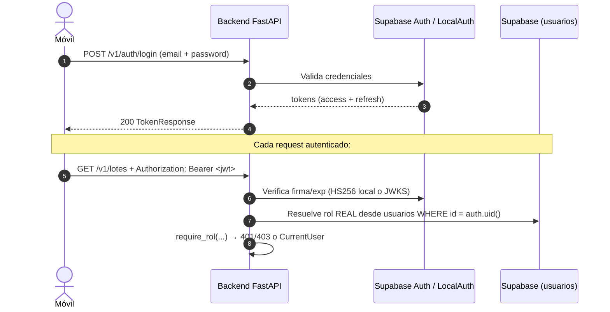

> El rol de negocio **jamás** se lee del claim `role` del JWT (Supabase siempre dice `authenticated`): se resuelve desde la tabla `usuarios` por el `sub`. Los tokens del proveedor local (desarrollo) son HS256; en producción se valida con JWKS (RS256/ES256) del proyecto real y el proveedor local queda bloqueado por configuración.

### Matriz de permisos RLS (por tabla)

| Tabla | productor | cooperativa | comprador | admin |
|---|---|---|---|---|
| `usuarios` | propia (lectura) | propia (lectura) | propia (lectura) | todo |
| `cooperativa` | — | — | — | lectura |
| `finca` | propias (lectura) | propias + de sus productores (lectura) | — | todo |
| `lotes` | de sus fincas | de sus fincas | — (solo `/verificar`) | todo |
| `lote_eventos` | de sus lotes (append-only) | de sus lotes (append-only) | — | todo |
| `qr_certificado` | de sus lotes | de sus lotes | — | todo |
| `pago` | de sus lotes (lectura) | propias (escritura) | lectura (comercio justo del lote) | todo |
| `propina` | de sus lotes (lectura) | de sus lotes (lectura) | propias (escritura) + lectura | todo |
| `verificacion` | de sus lotes | de sus lotes | — | todo |

**Aislamiento de tenant:** toda política RLS se resuelve **siempre** desde `auth.uid()` → `USUARIOS.id` del JWT (nunca desde un ID enviado por el cliente). La política de `PROPINA` es **propia** de su tabla: insertar solo si el JWT corresponde a `comprador_id`, y leer solo si el usuario es `comprador_id`, `productor_id`, cooperativa del lote o admin.

La matriz está implementada en `Backend/db/migrations/002_rls.sql` y es la misma regla que replica la capa de servicio en FastAPI (doble control, §12).

---

## 11. Decisiones de arquitectura (ADR) ya tomadas

1. **`backend = FastAPI + Supabase`**: las reglas de estados del café justifican una API propia (coherencia con la memoria técnica) y Supabase provee la persistencia con menos infraestructura propia.
2. **Event-sourcing ligero** (`lotes` + `lote_eventos`): separación estado vs su historial para inmutabilidad real.
3. **UUID generados en el móvil**: requisito del offline-first sin colisión central.
4. **QR con hash (sin estado frágil en BD)**: rápido y comprobable para el consumidor.
5. **Contrato separado del backend**: inmutabilidad de los pagos y auditoría independiente.
6. **`USUARIOS` como tabla central de identidad**: credenciales y wallet viven en `USUARIOS`; `PRODUCTOR`/`COOPERATIVA`/`COMPRADOR` solo agregan el rol de negocio (RLS se ancla a `USUARIOS`, no a la entidad concreta).
7. **Web3 en pausa en el MVP** (B7): el contrato `CoffeePayments.sol` se especifica en `docs/06-contratos.md` pero no se implementa en este milestone; el MVP usa `FakeGatewayPagos`. Evita deuda: la interfaz y la idempotencia (`idempotency_key UNIQUE`) ya están resueltas.
8. **Dinero como `real`/`float` con CHECK** según ERD; migrar a `NUMERIC`/`Decimal` es una mejora futura documentada (no bloquea el MVP).

Cada decisión se documenta en esta misma sección (ADR 1–8) con plantilla: Título · Contexto · Decisión · Consecuencias.

A continuación, los ADR 9–14 en el formato estándar **Contexto → Decisión → Opciones Consideradas → Consecuencias** (consistente con los ADR 1–8):

### ADR-9 — Mercado como proyección de solo lectura

- **Contexto:** la app y el pasaporte necesitan mostrar ofertas/comercio justo del café; escribir esa vista desde el móvil rompería la fuente de verdad y el aislamiento por tenant.
- **Decisión:** el mercado es una **proyección read-only** materializada por el backend (a partir de `LOTE`, `PAGO`, `PROPINA`); no existe `POST /mercado`.
- **Opciones consideradas:** (a) escritura directa desde el móvil al mercado — descartada por romper RLS; (b) vista SQL materializada con refresh — descartada por complejidad en MVP; (c) **proyección calculada en el servicio** — elegida.
- **Consecuencias:** vistas de oferta y Panel Comercio Justo siempre consistentes; ningún rol escribe el mercado; latencia mínima al ser un cálculo simple.

### ADR-10 — Propina al productor (100% directo, idempotente, bivalente)

- **Contexto:** el comprador quiere reconocer el trabajo del productor más allá de la venta; la comisión 3% de la venta no debe aplicarse a la propina.
- **Decisión:** tabla `PROPINA` con `clave_idempotencia UNIQUE`; el monto va **100%** al productor; `estado_propina` (`REGISTRADA → PENDIENTE → CONFIRMADA`) es **bivalente off-chain/on-chain** (igual que `PAGO`).
- **Opciones consideradas:** (a) propina dentro de `PAGO` — descartada: mezcla comisión; (b) propina solo on-chain — descartada: web3 en pausa (B7); (c) **tabla propia bivalente** — elegida.
- **Consecuencias:** el productor recibe el 100%; la idempotencia evita dobles envíos; cuando web3 se retome, la propina se liquida con el mismo mecanismo de firma.

### ADR-11 — Hash por etapa (cadena lineal + ancla raíz on-chain)

- **Contexto:** el pasaporte muestra el historial completo; un solo hash no demuestra que *cada etapa* no fue manipulada.
- **Decisión:** cada `LOTE_EVENTOS` lleva `hash_etapa` en **cadena lineal** (`hash_i = HASH(hash_{i-1} ‖ datos)` orden `registrado_en, id`); la raíz es `QR_CERTIFICADO.hash_sha256`, verificable con el QR y anclable on-chain **reusando `anclarHash()`**.
- **Opciones consideradas:** (a) hash único del lote — descartado: no aísla la etapa adulterada; (b) Merkle tree — descartado por complejidad en MVP; (c) **cadena lineal** — elegida por simplicidad y suficiente para el caso.
- **Consecuencias:** la verificación corta por `emitido_en`; editar cualquier evento rompe la raíz → 409; anclaje por etapa opcional cuando web3 se retome (B7).

### ADR-12 — Proceso del café ampliado (cadena completa con autotransiciones)

- **Contexto:** la memoria describe sub-etapas (fermentación, lavado, secado, reposo, clasificación) que no existían en la máquina original de 4 estados.
- **Decisión:** se conservan los **hitos** `CEREZA → PERGAMINO → ORO → TOSTADO → VENDIDO` (+ `RECHAZADO`) y se registran las sub-etapas como **autotransiciones** (mismo estado) con `TipoEvento` ampliado a **11 tipos** (`COSECHA`, `LIMPIEZA`, `DESPULPADO`, `FERMENTACION`, `LAVADO`, `SECADO`, `REPOSO`, `DESCASCARADO`, `CLASIFICACION`, `TOSTADO`, `VENTA`, `RECHAZADO`). **Aditiva, no destructiva**: los eventos viejos siguen siendo válidos.
- **Opciones consideradas:** (a) estados nuevos por sub-etapa — descartado: infla la máquina y rompe compatibilidad; (b) autotransiciones — elegido; (c) campos sueltos en el lote — descartado: pierde evidencia temporal.
- **Consecuencias:** no se saltan hitos; las sub-etapas solo se registran en su hito sin orden estricto; no hay retroceso tras `TOSTADO`; el historial completo queda en `lote_eventos`.

### ADR-13 — Estado del Día decorativo (sin contrato)

- **Contexto:** el dashboard quiere un "Estado del Día" motivacional; no tiene valor de trazabilidad ni lógica de dominio.
- **Decisión:** es un widget **decorativo** calculado en el cliente desde datos ya disponibles (lotes activos, última sincronización, clima local). **No tiene endpoint, tabla ni contrato.**
- **Opciones consideradas:** (a) endpoint propio — descartado: costo sin valor; (b) cálculo en cliente — elegido.
- **Consecuencias:** cero superficie de error; el backend nunca guarda UI decorativa (§12).

### ADR-14 — Evidencia fotográfica (Storage, url + sha256, fuera del hash canónico)

- **Contexto:** la trazabilidad pide respaldo visual (fotos del lote en campo).
- **Decisión:** la evidencia sube a **Supabase Storage**; `LOTE` guarda `evidencia_url` + `evidencia_sha256`. La evidencia **queda fuera del hash canónico** por etapa: el hash cubre los datos estructurales del evento, no los binarios.
- **Opciones consideradas:** (a) dentro del hash canónico — descartado: hace el hash frágil a re-uploads y pesado; (b) url + sha256 fuera del hash — elegido; (c) sin evidencia — descartado: no cumple la memoria.
- **Consecuencias:** la foto es verificable por su `sha256` (integridad del binario) sin inflar la cadena; el pasaporte puede enlazarla al mostrar el lote.

---

## 12. Buenas prácticas obligatorias en el desarrollo

### Backend (FastAPI / Python)
- Estructura modular: los routers declaran su propio `prefix`, `tags` y `dependencies` en el `APIRouter` (no en `include_router`).
- **Una operación HTTP = una función** (nunca mezclar `GET`/`POST` en el mismo handler).
- `Annotated` + `Depends` para toda inyección de dependencias; dependencias compartidas a nivel de router.
- **Tipos de retorno** en path operations (`-> LoteRead`): validan, filtran y serializan (evita exponer campos internos como la wallet o `hash_sha256` parcial).
- Endpoints de E/S **blocking** (Supabase SDK) en `def` síncrono (se ejecutan en threadpool), no dentro de `async` — evita bloquear el event loop.
- **Nunca** claves privadas en el código: solo variables de entorno (`.env` ignorado por git).
- Linter: Ruff. Pruebas: pytest (en `Backend/tests/`).

### Diseño orientado a objetos (dominio)
- El `Lote` es el **aggregate root**: toda modificación sobre él pasa por sus métodos (no se modifica por acceso directo).
- `LoteEvento` es un **value object inmutable** (creación única, sin setters) — nos garantiza trazabilidad.
- Los estados se modelan con el **patrón State** (o un mapa de transiciones `MaquinaEstados`), nunca con `if/case` gigantes.
- Repositorios y gateways se declaran como **interfaces** (`RepositorioLote`, `GatewayPagos`) → el dominio no depende de Supabase ni de Polygon (inversión de dependencias).
- Servicios de aplicación = capa de comportamiento; routers = solo presentación (ver §4 OOP y §6).

### Base de datos (PostgreSQL / Supabase)
- ENUM para estados, `TIMESTAMPTZ`, CHECK constraints, UUID `gen_random_uuid()`.
- `lote_eventos` como **append-only** (nada de UPDATE/DELETE).
- Índices para las consultas más usadas (búsqueda por código QR, historial por lote).
- RLS por cooperativa; la app nunca ve filas ajenas (skill Supabase best practices).
- **Read-model / proyección**: el mercado y el Panel Comercio Justo se materializan en el servicio (read-only) — nunca se escriben desde el móvil (ADR-9).
- **Hash por etapa**: `lote_eventos.hash_etapa` en cadena lineal; la raíz vive en `qr_certificado.hash_sha256` y se recalcula al verificar (ADR-11).
- **Evidencia fotográfica**: `evidencia_url` + `evidencia_sha256` en `LOTE` (Storage); fuera del hash canónico (ADR-14).

### Backend (FastAPI / Python)
- **No persistir UI decorativa**: el Estado del Día se computa en el cliente; el backend jamás guarda campos de presentación (ADR-13).

### Blockchain (Solidity)
- 0.8.0+, OpenZeppelin, `ReentrancyGuard`, *pull-over-push*, custom errors.
- Auditoría estática con **Slither** antes de desplegar en testnet.
- La llave privada de firma, fuera del repo.

### React Native (skills Vercel + Callstack)
- Navegación **nativa** (expo-router, native stack/tabs) en vez de JS navigators.
- Listas con **FlashList** (virtualización) — nunca `ScrollView` con `map`.
- Estado atómico (**Zustand/Jotai**) con selectores para minimizar re-renders.
- Imágenes con **expo-image**; preservar dimensiones (evita layout shift).
- Medir (profilers) antes de optimizar; no memoizar a ciegas.

---

## 13. Glosario (para hablar el mismo idioma)

| Término | Significado |
|---|---|
| **Lote** | Conjunto de café del mismo proceso/productor registrado (unidad de trazabilidad) |
| **Evento de estado** | Una transición registrada del lote (CEREZA → PERGAMINO, etc.) |
| **CEREZA** | Café en fruto rojo al momento de la cosecha |
| **PERGAMINO** | Café después de despulpado y secado |
| **ORO** | Café verde descascarado, listo para comercializar |
| **TOSTADO** | Café tostado → habilita el QR |
| **Certificado de Origen** | El QR: prueba digital de dónde y cómo se produjo el lote (finca, productor, altitud, procesos) |
| **QR público** | Código escaneable que porta el Certificado de Origen y verifica la trazabilidad |
| **Smart Contract** | Programa en blockchain que ejecuta el pago justo (comisión 3%) |
| **Append-only** | Tabla donde solo se inserta, jamás se edita (evidencia) |
| **Offline-first** | La app funciona sin internet y sincroniza después |
| **LWW** | Last-Write-Wins: el último cambio gana los conflictos de sync |
| **Aggregate root** | Entidad (el Lote) que garantiza consistencia sobre su historia |
| **Variedad** | Cultivar de café (ej. Borbón, Caturra, Gesha, Típica) registrado en el lote |
| **Beneficiado húmedo** | Proceso con agua: despulpado + fermentación + lavado (producción de café lavado) |
| **Beneficiado seco** | Proceso sin agua: el fruto se seca entero y se descascara después (café natural) |
| **Lavado** | Método húmedo: se remueve el mucílago con agua tras la fermentación |
| **Natural** | Método seco: el fruto se seca completo con el grano dentro (notas afrutadas) |
| **Honey** | Método intermedio: se despulpa pero el mucílago se seca pegado al grano (semi-lavado con miel) |
| **Fermentación** | Sub-etapa (PERGAMINO) que desarrolla sabor; se registra método y horas |
| **Humedad %MC** | Contenido de humedad del grano (*moisture content*) en %; óptimo de exportación ~10–12% |
| **Puntaje SCA** | Calificación de taza 0–100 de la *Specialty Coffee Association*; ≥80 = café especial |
| **Reposo** | Sub-etapa (PERGAMINO) de descanso del grano (días) antes de descascarar |
| **Pasaporte de Café** | Evolución del Certificado de Origen: verificación pública con variedad, método, altitud, humedad, SCA y timeline con hash por etapa (§8) |
| **Propina** | Pago voluntario del comprador al productor, 100% directo, idempotente y bivalente (ADR-10) |
| **Autotransición** | Evento que no cambia de estado (ej. CEREZA → CEREZA): registra sub-etapas sin mover el hito |

---

## 14. Flujo de desarrollo propuesto (equipo pequeño)

1. **Dominio**: definir y documentar la máquina de estados (hitos + autotransiciones) + reglas → §4 (consolidado; Issue 1).
2. **Modelo de datos**: ERD + migración inicial (incluye `PROPINA` y columnas por etapa) → §5 + `db/migrations/` (Issue 2).
3. **API contrato**: rutas + schemas Pydantic + flujo → §6–§8 + `docs/06-contratos.md` (Issue 3).
4. **UI mobile**: wireframes + árbol de navegación (4 tabs + grupo público `verificar/`) → `mobile/` (Issue 4).
5. **Offline-sync**: diseño completo → §7.5 (Issue 5).
6. **Backend**: montar `Backend/` (FastAPI) empezando por el corazón (máquina de estados + hash por etapa + Pasaporte público).
7. **Móvil**: `mobile/` con Expo — pasos: **dashboard Mi Finca** (bento + alerta offline + FAB) → **wizard de 3 pasos** (`lotes/nuevo`) → **escáner/pasaporte** (`verificar/` + `verificar/[codigo]`) → **comercio justo** (`mercado/[loteId]` con donut 97/3 + propina).
8. **Contracts**: `CoffeePayments.sol` + pruebas + deploy en testnet (anclaje `anclarHash` por etapa).

Cada integrante trabaja en su rama por feature; `docs/ARCHITECTURE.md` es la fuente única de verdad del diseño.

---

*Bean Trust — Memoria técnica y modelo de negocio, InnovaTecNM 2026.*