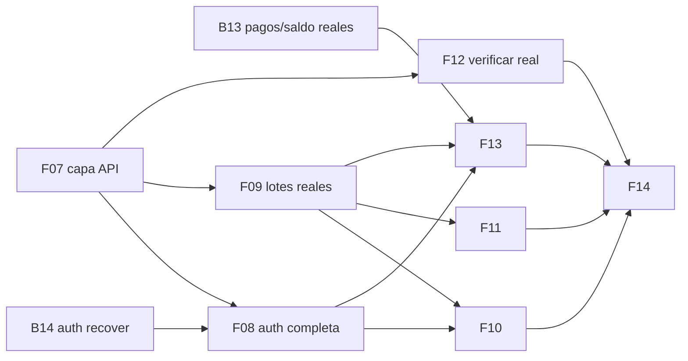

# Backlog ejecutable — app funcional (espejo de GitHub)

Estas 10 issues son el espejo local de las issues abiertas en GitHub
(#26–#35) y del proyecto **BeanTrust** (columna *Todo*). Cada archivo tiene
contexto verificado del código, alcance, criterios de aceptación y
dependencias. Las instrucciones de ejecución para el agente están en
[`CLAUDE.md`](../CLAUDE.md) (raíz del repo).

> **Regla transversal de dinero:** todo el flujo de pagos/propinas es
> **simulado (test)** vía `FakeGatewayPagos`. Sin dinero real, sin pasarelas
> y sin blockchain — web3 sigue en pausa (B7).

## Orden recomendado y dependencias

| Orden | Issue | GitHub | Qué entrega | Depende de |
|---|---|---|---|---|
| 1 | [F07](F07-capa-api-real.md) | #28 | Capa API real + refresh 401 + tests | — |
| 2 | [B13](B13-pagos-saldo-reales.md) | #26 | `GET /v1/pagos` y `/saldo` reales (simulado) | — |
| 3 | [B14](B14-auth-recover.md) | #27 | Recover de contraseña (token one-shot) | — |
| 4 | [F08](F08-auth-completa.md) | #29 | Register/recover reales + rol con `/auth/me` | F07, B14 |
| 5 | [F09](F09-lotes-reales.md) | #30 | Lista (cursor) + detalle con timeline real | F07 |
| 6 | [F10](F10-wizard-conectado.md) | #31 | Wizard → `POST /v1/lotes` idempotente | F07, F08 |
| 7 | [F11](F11-registrar-eventos.md) | #32 | Avanzar estado del lote (UI nueva, 11 tipos) | F09 |
| 8 | [F12](F12-verificar-real.md) | #33 | Pasaporte real + escáner `expo-camera` | F07 |
| 9 | [F13](F13-mercado-propinas.md) | #34 | Mercado/propinas reales (simulado) + donut | B13, F08, F07 |
| 10 | [F14](F14-pulido-app-funcional.md) | #35 | Acciones muertas, Generar QR, tokens | F09–F13 |

## Fuera de este batch (fase posterior)

- **Offline-first real** (SQLite + cola + NetInfo + `POST /v1/sync`) — decisión
  de producto: la app se conecta online primero.
- **Evidencia fotográfica** (cámara + Supabase Storage, ADR-14) — con B11.
- [#17 B11](https://github.com/FerLpz55/BeanTrust/issues/17) Supabase real,
  [#18 B12](https://github.com/FerLpz55/BeanTrust/issues/18) deploy Railway,
  [#13 B7](https://github.com/FerLpz55/BeanTrust/issues/13) web3 — ya existen
  abiertas en GitHub.

## Al trabajar una issue

1. Actualiza el estado en el encabezado del archivo (`Todo → In Progress → Done`).
2. Marca las casillas de criterios conforme se cumplen.
3. Mantén el archivo sincronizado si el alcance cambia (espejo de GitHub:
   `gh issue edit <n>` para reflejarlo allá).
